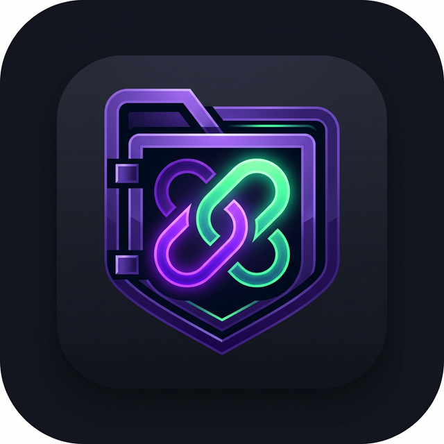

<div align="center">
  

  # LinkVault

  **The unified command center for your digital workspace.**
  <br />
  Organize, secure, and collaborate on links, files, and directories.

  [](https://dotnet.microsoft.com/)
  [](https://reactjs.org/)
  [](https://vitejs.dev/)
  [](https://tailwindcss.com/)
  [](https://www.postgresql.org/)
</div>

---

## 🚀 Overview

**Bring order to your digital chaos.** LinkVault is a centralized, secure workspace designed to help you and your team manage digital assets without the friction. Whether you are organizing vital project links, securely storing files, or managing team access via directories, LinkVault provides an enterprise-grade but consumer-simple interface.

## ✨ Features

*   **Smart Directories:** Organize links, files, and resources into nested, easy-to-navigate folders with nullable root hierarchy.
*   **Team Workspaces:** Built from the ground up for collaboration with strict Role-Based Access Control (Admin, Manager, Member, Viewer) and tenant isolation.
*   **Authenticated File Vault:** Fully authenticated file downloads via Bearer JWT or 60-second single-use download tickets (`/api/files/{id}/download`). No unauthorized static file exposure.
*   **Organization-Scoped Sharing:** Safe external sharing enforcing `CanShare` policy and tenant boundaries with download limits and password protection.
*   **Safe Upload Inspection:** Magic byte verification for PDF, PNG, JPEG, and Office documents, with active script scanning and forced attachment downloads for SVGs to eliminate stored XSS.
*   **Brute-Force & Rate Limiting:** Dedicated rate limiting on authentication and sensitive endpoints (10 req/min per IP) with automatic `Retry-After` headers.
*   **Secret & Startup Validation:** Fail-fast startup validation preventing insecure default JWT keys or unconfigured databases from running.
*   **Admin-Only Audit Logs:** Enterprise audit logging restricted exclusively to administrators.
*   **Frictionless Access:** Sign in instantly with Google, GitHub, or LinkedIn SSO.
*   **Real-Time Collaboration:** Activity tracking, live updates, and team chat powered by SignalR web sockets.

## 🛠️ Technology Stack

LinkVault is built using a modern, scalable, and high-performance stack:

**Frontend (Client)**
- **Framework:** React 18 with TypeScript
- **Build Tool:** Vite
- **Styling:** Tailwind CSS + Vanilla CSS (Custom Design System)
- **Routing:** React Router v6
- **State Management:** Zustand
- **Animations:** Framer Motion

**Backend (API)**
- **Framework:** ASP.NET Core 8 Web API (C#)
- **ORM:** Entity Framework Core
- **Database:** PostgreSQL
- **Real-Time:** ASP.NET Core SignalR
- **Authentication:** JWT (JSON Web Tokens) & OAuth (Google, GitHub, LinkedIn)

## 📦 Getting Started (Local Development)

### 1. Prerequisites
- [Node.js](https://nodejs.org/) (v18+)
- [.NET 8 SDK](https://dotnet.microsoft.com/en-us/download/dotnet/8.0)
- [PostgreSQL](https://www.postgresql.org/)

### 2. Clone the Repository
```bash
git clone https://github.com/Musavirdar/LinkVault.git
cd LinkVault
```

### 3. Backend Setup
1. Navigate to the backend directory: `cd backend`
2. Create `appsettings.Development.json` and configure your local PostgreSQL database connection string and JWT Secret.
3. Apply database migrations: `dotnet ef database update`
4. Run the API: `dotnet run` (Runs on `http://localhost:5246` by default)

### 4. Frontend Setup
1. Open a new terminal and navigate to the frontend directory: `cd app`
2. Install dependencies: `npm install`
3. Start the Vite development server: `npm run dev` (Runs on `http://localhost:5173`)

## 🌐 Deployment
LinkVault is fully configured for production deployment:
- **Frontend:** Pre-configured for seamless deployment on [Vercel](https://vercel.com) (includes `vercel.json` for SPA routing).
- **Backend:** Ready for deployment on platforms like [Render](https://render.com) or [Railway] natively via Docker or as a Web Service. Ensure you supply `.env` equivalents for connection strings and secrets in production.

## 🛡️ License
This project is proprietary and confidential. All rights reserved.
