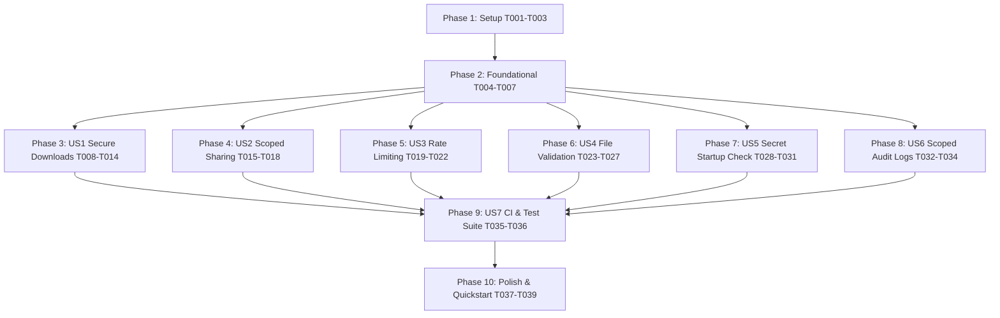

# Tasks: Security, Access Control & Quality Hardening

**Feature**: `001-security-access-hardening`  
**Input**: [spec.md](file:///c:/Users/darmu/OneDrive/Attachments/Desktop/LinkVault-main/specs/001-security-access-hardening/spec.md), [plan.md](file:///c:/Users/darmu/OneDrive/Attachments/Desktop/LinkVault-main/specs/001-security-access-hardening/plan.md), [data-model.md](file:///c:/Users/darmu/OneDrive/Attachments/Desktop/LinkVault-main/specs/001-security-access-hardening/data-model.md), [api-contracts.md](file:///c:/Users/darmu/OneDrive/Attachments/Desktop/LinkVault-main/specs/001-security-access-hardening/contracts/api-contracts.md)  
**Status**: Completed

---

## Phase 1: Setup (Shared Infrastructure)

**Purpose**: Project preparation and test harness initialization

- [X] T001 Create test project `LinkVault-main/backend/LinkVaultApi.Tests/LinkVaultApi.Tests.csproj` with xUnit, `Microsoft.AspNetCore.Mvc.Testing`, FluentAssertions, and Moq dependencies
- [X] T002 Add `LinkVaultApi.Tests` project to solution or configure reference to `LinkVaultApi.csproj`
- [X] T003 [P] Create custom test fixture `CustomWebApplicationFactory.cs` in `LinkVault-main/backend/LinkVaultApi.Tests/Helpers/` configuring in-memory or test database and mocked services

---

## Phase 2: Foundational (Blocking Prerequisites)

**Purpose**: Core model and database schema additions that block downstream stories

- [X] T004 Create `DownloadTicket` entity class in `LinkVault-main/backend/Models/DownloadTicket.cs` with `Id`, `ResourceId`, `UserId`, `OrganizationId`, `ExpiresAtUtc`, and `IsUsed`
- [X] T005 Register `DbSet<DownloadTicket> DownloadTickets` in `LinkVault-main/backend/Data/AppDbContext.cs` and configure entity indexes (`ExpiresAtUtc`, `ResourceId`) in `OnModelCreating`
- [X] T006 [P] Update `Directory` entity in `LinkVault-main/backend/Models/Directory.cs` to ensure `ParentDirectoryId` is explicitly `Guid?` (nullable) with no empty Guid fallback
- [X] T007 Generate and apply EF Core migration `AddDownloadTicketsAndNullableDirectory` or update DB schema migration scripts in `LinkVault-main/backend/`

**Checkpoint**: Foundation ready — database entities and test harness initialized.

---

## Phase 3: User Story 1 — Secure and Authorized File Access (Priority: P1) 🎯 MVP

**Goal**: Disallow unauthenticated static file access; provide authenticated ticket/Bearer download endpoint with tenancy and directory checks.

**Independent Test**: Requesting `/uploads/...` returns 404. Requesting `GET /api/files/{id}/download` without auth returns 401; with another org's token returns 404; with valid auth returns 200 and streams the file.

### Tests for User Story 1
- [X] T008 [P] [US1] Create integration test `DownloadEndpointTests.cs` in `LinkVault-main/backend/LinkVaultApi.Tests/Integration/` testing unauthenticated, unauthorized, and authorized download flows

### Implementation for User Story 1
- [X] T009 [US1] Remove static files middleware mount for `/uploads` in `LinkVault-main/backend/Program.cs` (`app.UseStaticFiles(...)` pointing to uploads folder)
- [X] T010 [US1] Create `FilesController.cs` in `LinkVault-main/backend/Controllers/FilesController.cs` with `[Authorize]` attribute
- [X] T011 [US1] Implement `POST /api/files/{id}/download-ticket` in `FilesController.cs` verifying org membership & directory permission, saving 60-second single-use ticket in `AppDbContext`
- [X] T012 [US1] Implement `GET /api/files/{id}/download` in `FilesController.cs` accepting either `Authorization: Bearer <token>` or `?ticket=<guid>`, streaming file via `IStorageProvider.GetAsync` with proper `Content-Type` and `Content-Disposition`
- [X] T013 [US1] Invalidate/mark `DownloadTicket` as used (`IsUsed = true`) atomically upon download in `FilesController.cs`
- [X] T014 [US1] Update frontend API clients/download links in `LinkVault-main/app/src/` to request download tickets or call `/api/files/{id}/download` instead of static `/uploads` URLs

**Checkpoint**: User Story 1 functional and independently testable. Uploaded files cannot be accessed anonymously.

---

## Phase 4: User Story 2 — Organization-Scoped Resource Sharing (Priority: P1)

**Goal**: Ensure share links cannot be created for cross-tenant resources and require the `CanShare` policy.

**Independent Test**: Attempting to create a share link for a resource belonging to a different organization returns 404. Creating a share link without the `CanShare` policy returns 403.

### Tests for User Story 2
- [X] T015 [P] [US2] Create integration test `ShareControllerTests.cs` in `LinkVault-main/backend/LinkVaultApi.Tests/Integration/` verifying org isolation and `CanShare` policy on `POST /api/share`

### Implementation for User Story 2
- [X] T016 [US2] Add `[Authorize(Policy = "CanShare")]` attribute to `CreateShareLink` action in `LinkVault-main/backend/Controllers/ShareController.cs`
- [X] T017 [US2] Update resource query in `ShareController.cs` to filter by both `ResourceId == request.ResourceId` AND `OrganizationId == currentOrgId` (extracted from user claims)
- [X] T018 [US2] Add audit logging in `ShareController.cs` recording share link creation event with user ID, resource ID, and organization ID

**Checkpoint**: User Story 2 functional. Cross-tenant sharing impossible.

---

## Phase 5: User Story 3 — Protection Against Brute Force and Rate Limiting (Priority: P1)

**Goal**: Configure and enforce strict rate limiting on authentication and sensitive endpoints.

**Independent Test**: Exceeding 10 requests per minute on `/api/auth/login` or `/api/auth/verify-2fa` returns HTTP 429 Too Many Requests with `Retry-After` header.

### Tests for User Story 3
- [X] T019 [P] [US3] Create integration test `AuthRateLimitingTests.cs` in `LinkVault-main/backend/LinkVaultApi.Tests/Integration/` asserting 429 after 10 requests within 1 minute

### Implementation for User Story 3
- [X] T020 [US3] Define named rate-limiter policy `"auth"` (10 requests/minute per client IP) in `LinkVault-main/backend/Program.cs` alongside existing global limiter
- [X] T021 [US3] Ensure `app.UseRateLimiter()` is properly placed in the ASP.NET Core middleware pipeline in `LinkVault-main/backend/Program.cs` (after CORS/routing, before authentication)
- [X] T022 [US3] Apply `[EnableRateLimiting("auth")]` to `AuthController.cs` login, register, password reset, and 2FA verification endpoints in `LinkVault-main/backend/Controllers/AuthController.cs`

**Checkpoint**: User Story 3 functional. Brute-force and credential stuffing attacks throttled.

---

## Phase 6: User Story 4 — Safe File Upload Validation & XSS Prevention (Priority: P2)

**Goal**: Validate file uploads via magic bytes, restrict MIME types, force SVG downloads as attachment, and sanitize file names.

**Independent Test**: Uploading an executable with a `.pdf` extension fails validation (400). Uploading an SVG file sets `Content-Disposition: attachment` on download.

### Tests for User Story 4
- [X] T023 [P] [US4] Create unit test `FileValidationServiceTests.cs` in `LinkVault-main/backend/LinkVaultApi.Tests/Unit/` testing magic byte validation for PDF, PNG, JPEG, SVG, and disguised executables

### Implementation for User Story 4
- [X] T024 [P] [US4] Create `IFileValidationService` interface and `FileValidationService` implementation in `LinkVault-main/backend/Services/FileValidationService.cs` inspecting file headers/magic bytes
- [X] T025 [US4] Register `IFileValidationService` as a singleton/scoped service in `LinkVault-main/backend/Program.cs`
- [X] T026 [US4] Integrate `IFileValidationService` into `LinkVault-main/backend/Controllers/FileUploadController.cs` validating magic bytes, rejecting disallowed MIME types, and sanitizing original file names
- [X] T027 [US4] Configure `FilesController.cs` download streaming to enforce `Content-Disposition: attachment; filename="..."` and `X-Content-Type-Options: nosniff` for SVG and active MIME types

**Checkpoint**: User Story 4 functional. Disguised malicious files rejected; SVG XSS prevented.

---

## Phase 7: User Story 5 — Environment-Driven Secrets & Startup Validation (Priority: P2)

**Goal**: Prevent startup if JWT secret or DB connection strings are insecure, missing, or default placeholders; clean up unused legacy dependencies.

**Independent Test**: Running the app with default placeholder JWT secret throws `InvalidOperationException` and terminates process before accepting traffic.

### Tests for User Story 5
- [X] T028 [P] [US5] Create unit test `StartupValidationTests.cs` in `LinkVault-main/backend/LinkVaultApi.Tests/Unit/` verifying startup failure on weak/default JWT key and short keys (< 32 bytes)

### Implementation for User Story 5
- [X] T029 [US5] Add startup validation logic in `LinkVault-main/backend/Program.cs` verifying `Jwt:Key` is at least 256-bit (32 bytes), not equal to default placeholder, and DB connection string is non-empty
- [X] T030 [US5] Remove legacy or unused packages from `LinkVault-main/backend/LinkVaultApi.csproj` (e.g. obsolete JWT packages or unreferenced legacy dependencies)
- [X] T031 [US5] Update `LinkVault-main/backend/appsettings.Development.json` and documentation with secure secret placeholders and `.env.example` guidance

**Checkpoint**: User Story 5 functional. App refuses to boot with insecure credentials.

---

## Phase 8: User Story 6 — Scoped Audit Log Visibility & Data Integrity (Priority: P2)

**Goal**: Restrict audit logs strictly to Admin role; ensure Directory foreign keys properly support root folders via nullable Guid.

**Independent Test**: Non-admin calling `GET /api/audit` receives 403 Forbidden. Creating root directory saves `ParentDirectoryId = null` rather than empty Guid.

### Tests for User Story 6
- [X] T032 [P] [US6] Create integration test `AuditControllerTests.cs` in `LinkVault-main/backend/LinkVaultApi.Tests/Integration/` asserting 403 for standard user and 200 for Admin

### Implementation for User Story 6
- [X] T033 [US6] Add `[Authorize(Roles = "Admin")]` to `LinkVault-main/backend/Controllers/AuditController.cs` and ensure tenant filtering (`OrganizationId`) is enforced on all audit queries
- [X] T034 [US6] Review and refactor `LinkVault-main/backend/Controllers/DirectoriesController.cs` or directory service to use `null` for root folder parent IDs instead of `Guid.Empty`

**Checkpoint**: User Story 6 functional. Audit data protected from standard members; directory hierarchy clean.

---

## Phase 9: User Story 7 — Core Security Test Suite & Automated CI (Priority: P3)

**Goal**: Full automated test verification and CI workflow pipeline.

**Independent Test**: Running `dotnet test` executes all security integration tests successfully; GitHub Actions workflow passes.

### Implementation for User Story 7
- [X] T035 [US7] Create GitHub Actions workflow `.github/workflows/ci.yml` compiling backend, running `dotnet test`, and building frontend (`npm run build`)
- [X] T036 [US7] Verify all test suites pass locally via `dotnet test LinkVault-main/backend/LinkVaultApi.Tests`

**Checkpoint**: User Story 7 functional. CI pipeline active and validating security test suite.

---

## Phase 10: Polish & Cross-Cutting Concerns

**Purpose**: Final security review, quickstart validation, and documentation

- [X] T037 [P] Execute quickstart validation guide in `specs/001-security-access-hardening/quickstart.md`
- [X] T038 Review and verify no regressions in existing frontend flows (upload, folder navigation, share link viewing)
- [X] T039 Update `README.md` or API documentation reflecting authenticated download and security hardening changes

---

## Dependencies & Execution Order

### Phase Dependencies
- **Phase 1: Setup**: No dependencies — can start immediately.
- **Phase 2: Foundational**: Depends on Phase 1 — BLOCKS all User Stories.
- **User Stories (Phase 3–8)**: Depend on Phase 2 completion. Can proceed sequentially by priority (P1 -> P2 -> P3) or in parallel.
- **Phase 9: CI & Test Suite**: Depends on User Stories implementation.
- **Phase 10: Polish**: Depends on all previous phases.

### Within Each User Story
- Tests must be written and verified before implementation.
- Model and DB updates before services.
- Services before controllers/endpoints.
- Endpoint validation before UI integration.
