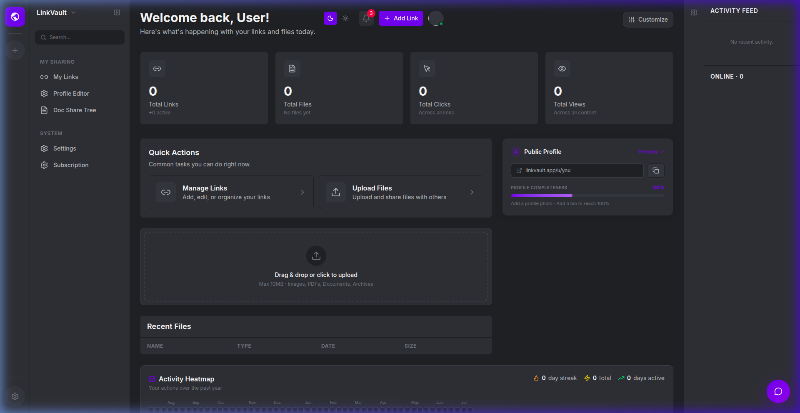
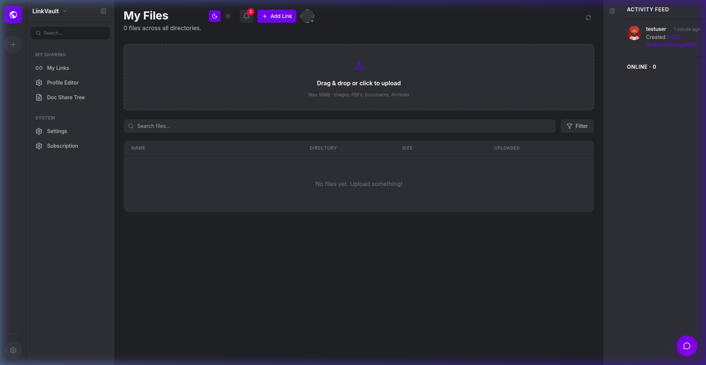
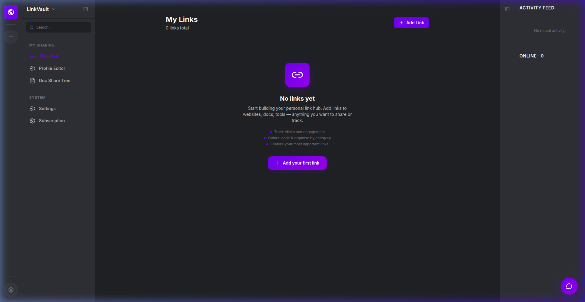
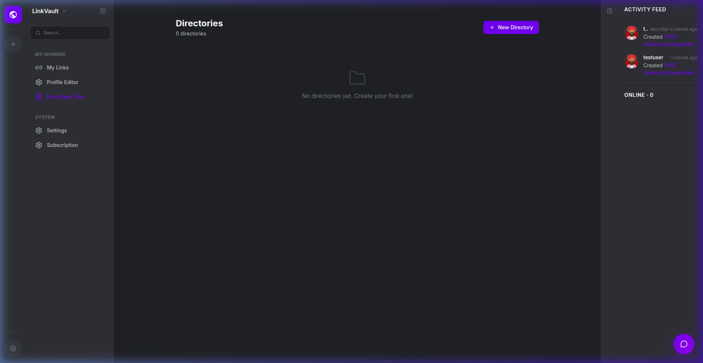
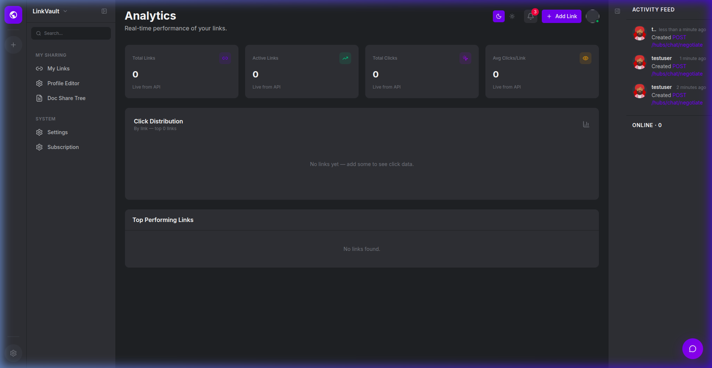
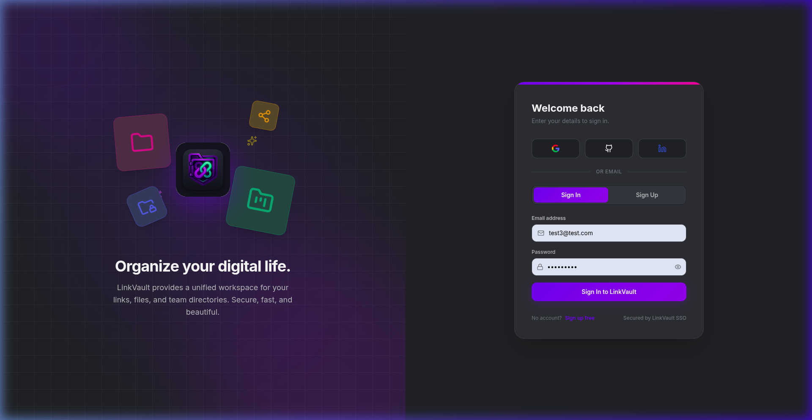

# LinkVault — Enterprise Digital Workspace & Secure Content Hub

[](https://github.com/Musavirdar/LinkVault/actions/workflows/ci.yml)
[](https://dotnet.microsoft.com/)
[](https://react.dev/)
[](https://www.typescriptlang.org/)
[](LICENSE)

**LinkVault** is an enterprise-grade, multi-tenant digital workspace combining secure file management, link hubs, hierarchical directories, real-time collaboration, and audit telemetry in a single high-performance platform.

Designed for organizations requiring strict tenant isolation, zero-trust file streaming, and end-to-end audit compliance.

---

## 📸 Product Overview & Highlights



### Key Capabilities

| Feature | Description | Screenshot |
|---|---|---|
| **Secure Files & Chunked Uploads** | Large-file chunked uploading with real-time assembly, magic-byte inspection, SVG XSS sanitization, and atomic single-use download tickets. |  |
| **Link Hub & Public Profiles** | Centralized link vault with link scheduling, click tracking, custom slugs, and customizable public profile pages. |  |
| **Hierarchical Directories** | Multi-level directory structures with role-based folder permissions, recursive navigation, and inheritance. |  |
| **Real-Time Analytics & Audit** | Built-in analytics tracking views, downloads, clicks, and immutable admin audit trails with actor and IP attribution. |  |
| **Enterprise Authentication** | JWT authentication with refresh tokens, TOTP two-factor authentication (2FA), OAuth (Google, GitHub), and reverse-proxy rate limiting. |  |

---

## 🛠️ Architecture & Tech Stack

```text
├── app/                        # Frontend: React 18 + TypeScript + Vite + Tailwind CSS
├── backend/                    # Backend API: ASP.NET Core 8 Web API + EF Core 8
│   ├── Controllers/            # REST API endpoints & chunked upload controllers
│   ├── Data/                   # LinkVaultDbContext & PostgreSQL configuration
│   ├── Middleware/             # Security headers, rate limiting, audit & error handling
│   ├── Models/                 # Domain entities & relationships
│   ├── Services/               # File validation, storage providers, JWT, auth
│   └── LinkVaultApi.Tests/     # xUnit integration and unit test suite
├── docker-compose.yml          # Containerized local environment (PostgreSQL & API)
├── screenshots/                # Application UI walkthrough imagery
└── sharedb1.sln                # Root .NET Solution file
```

- **Frontend**: React 18, TypeScript, Tailwind CSS, Lucide React, Vite
- **Backend API**: ASP.NET Core 8 Web API, Entity Framework Core 8, SignalR (Real-time collaboration)
- **Database**: PostgreSQL 16 (with connection pooling and automatic migrations)
- **Storage**: Pluggable storage provider architecture (Local filesystem / Cloud storage abstraction)
- **Security**: Strict startup validation, Magic-byte verification, Atomic DB ticket redemption, Reverse-proxy IP partition

---

## 🚀 Getting Started

### Prerequisites
- [.NET 8 SDK](https://dotnet.microsoft.com/download/dotnet/8.0)
- [Node.js 18+](https://nodejs.org/) & npm
- [PostgreSQL 16](https://www.postgresql.org/) or [Docker Desktop](https://www.docker.com/)

### 1. Environment Setup

Copy example environment configurations and provide your local credentials:

```bash
# Set runtime environment variables
export ConnectionStrings__DefaultConnection="Host=localhost;Port=5432;Database=linkvault;Username=postgres;Password=your_secure_password"
export JwtSettings__Secret="your-at-least-32-byte-long-secure-production-key-here"
```

*(On Windows PowerShell):*
```powershell
$env:ConnectionStrings__DefaultConnection = "Host=localhost;Port=5432;Database=linkvault;Username=postgres;Password=your_secure_password"
$env:JwtSettings__Secret = "your-at-least-32-byte-long-secure-production-key-here"
```

### 2. Run with Docker Compose

```bash
docker-compose up -d
```

### 3. Run Locally from Source

#### Backend API
```powershell
cd backend
dotnet run
```
API runs on `http://localhost:5000` (Swagger available at `http://localhost:5000/swagger` in development).

#### Frontend Client
```powershell
cd app
npm install
npm run dev
```
Client runs on `http://localhost:5173`.

### 4. Running Automated Tests

```powershell
dotnet test sharedb1.sln
```

---

## 🔒 Security Hardening & Zero-Trust Architecture

LinkVault enforces defense-in-depth across the application lifecycle:

1. **Zero-Secret Configuration**: No committed credentials or passwords in any configuration file (`appsettings.json`, `docker-compose.yml`, `.env*`).
2. **Strict Fail-Fast Startup Validation**: Startup validation actively detects and halts boot if keys match known default placeholders, compromised passwords, or keys under 32 bytes.
3. **Atomic Download Ticket Consumption**: Single-use download tickets are consumed via database-level atomic operations, eliminating concurrent race-condition replay attacks while validating that the target resource and user are active.
4. **Deep File Content Validation**: Magic-byte inspection for all uploads, including full-payload streaming validation of assembled chunked files and complete SVG sanitization against script injection.
5. **Reverse-Proxy-Aware Rate Limiting**: `UseForwardedHeaders` configures forwarded proxy headers (`X-Forwarded-For`, `X-Forwarded-Proto`) at the top of the HTTP pipeline, ensuring rate-limiting partitions correctly by client IP in production.
6. **Cloud Credential Remediation & Invalidation**: Permanently purged cloud deployment configuration files (`.env.render`), applied universal `.env*` ignore rules, and blacklisted compromised passwords and placeholder JWT strings in `StartupValidator.cs`.

---

## 📐 Engineering & Specifications (Spec-Driven Development)

LinkVault is developed under official **[GitHub Spec Kit](https://github.com/github/spec-kit)** methodology (Spec-Driven Development). Feature specifications, plans, and task breakdowns are maintained as first-class architectural artifacts:

- `specs/001-security-access-hardening/`: Core access control, upload validation, rate limiting, and audit isolation.
- `specs/002-core-hardening-and-cleanup/`: Repository canonicalization, zero-secret enforcement, chunked upload validation, atomic ticket consumption, and proxy rate limiting.
- `specs/003-purge-committed-credentials/`: Purge of committed credentials, universal environment file ignore rules, fail-fast startup blacklists, and Render secret rotation runbook.

### Spec Kit Workflow Commands

| Command | Skill | Purpose |
|---|---|---|
| `/speckit-specify [desc]` | `speckit-specify` | Create or update feature specification |
| `/speckit-clarify` | `speckit-clarify` | Identify and clarify ambiguous spec requirements |
| `/speckit-plan [feature]` | `speckit-plan` | Generate architecture and implementation plan |
| `/speckit-tasks [feature]` | `speckit-tasks` | Break plan down into dependency-ordered atomic tasks |
| `/speckit-implement [feature]` | `speckit-implement` | Execute tasks sequentially with test verification |
| `/speckit-converge [feature]` | `speckit-converge` | Verify completed implementation against spec |

---

## 📄 License

This project is licensed under the MIT License - see the [LICENSE](LICENSE) file for details.
