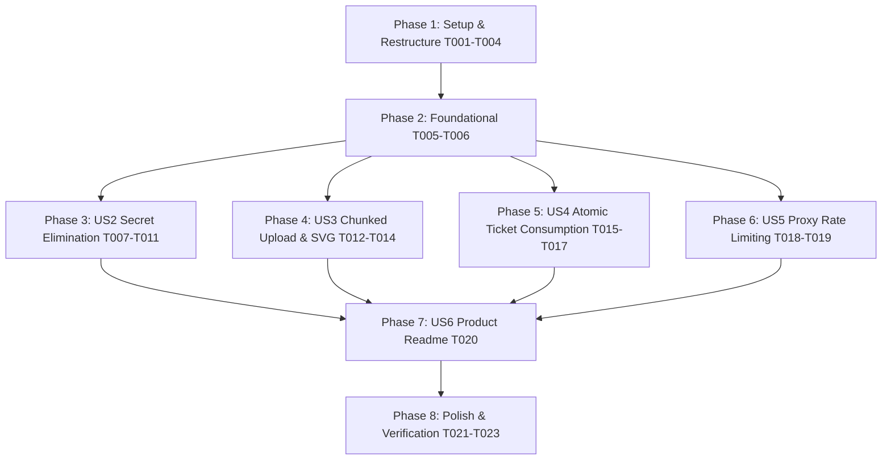

# Tasks: Core Hardening, Secret Protection & Repository Restructure

**Feature**: `002-core-hardening-and-cleanup`  
**Input**: [spec.md](spec.md), [plan.md](plan.md), [data-model.md](data-model.md), [contracts/api-contracts.md](contracts/api-contracts.md)  
**Status**: Ready for Implementation

---

## Phase 1: Setup & Repository Restructure (Priority: P1) 🎯 MVP Foundation

**Purpose**: Move all application code out of the nested folder to the repository root, eliminate duplicate configurations, and clean up untracked artifacts.

- [X] T001 Promote contents of `LinkVault-main/` (`app/`, `backend/`, `sharedb1.sln`, `docker-compose.yml`, `screenshots/`, `README.md`) to repository root and delete the empty `LinkVault-main/` folder
- [X] T002 Delete duplicate `LinkVault-main/.github/` directory and update root `.github/workflows/ci.yml` so all test and build steps use root paths without fallback logic
- [X] T003 [P] Update root `.gitignore` to ignore tool scaffolding (`.specify/`, `.agents/`, `AGENTS.md`) and delete tracked non-code presentation files (`LinkVault_Walkthrough.pptx`, `ponytail.md`, `info.md`) from git tracking
- [X] T004 Verify the promoted root solution builds and runs tests cleanly via `dotnet test sharedb1.sln`

**Checkpoint**: Repository layout is clean and canonical at the root level; no nested directories remain.

---

## Phase 2: Foundational (Blocking Prerequisites)

**Purpose**: Ensure build configurations and test harnesses operate on root-level paths.

- [X] T005 Update `backend/LinkVaultApi.csproj` and `sharedb1.sln` project references to ensure test project and API resolve from root paths
- [X] T006 [P] Update `backend/LinkVaultApi.Tests/Helpers/CustomWebApplicationFactory.cs` to resolve content root paths and environment settings from root `backend/`

**Checkpoint**: Solution and test fixtures compile and resolve correctly at the root level.

---

## Phase 3: User Story 2 — Zero-Secret Configuration & Strict Startup Validation (Priority: P1)

**Goal**: Eliminate hardcoded secrets from configuration files and enforce strict startup validation that blocks committed default keys.

**Independent Test**: Running the API with previously committed keys or default passwords throws `InvalidOperationException` at startup; running with fresh environment variables boots normally.

### Tests for User Story 2
- [X] T007 [P] [US2] Update unit tests in `backend/LinkVaultApi.Tests/Unit/StartupValidationTests.cs` verifying rejection of known committed keys (`linkvault-default-key-override...`, `linkvault123`, `lv-dev-secret-key...`)

### Implementation for User Story 2
- [X] T008 [US2] Sanitize `backend/appsettings.json` and `backend/appsettings.Development.json` by stripping all real secrets, database passwords, and JWT keys, replacing them with empty strings
- [X] T009 [US2] Update `docker-compose.yml` to replace committed secrets with environment variable interpolations (`${JWT_SECRET}`, `${POSTGRES_PASSWORD}`)
- [X] T010 [US2] Enhance `backend/Services/StartupValidator.cs` to actively reject known committed default strings, passwords (`linkvault123`), and JWT keys shorter than 32 bytes
- [X] T011 [US2] Update `backend/Program.cs` to ensure `StartupValidator.Validate(builder.Configuration)` runs prior to service configuration

**Checkpoint**: Zero credentials committed in configuration files; API refuses boot on insecure or committed keys.

---

## Phase 4: User Story 3 — Full Content Validation for Chunked Uploads & SVG Sanitization (Priority: P1)

**Goal**: Prevent validation bypasses by enforcing magic-byte inspection on assembled chunked uploads and scanning entire SVG payloads for scripts.

**Independent Test**: Uploading a disguised PE/ELF executable or an SVG with `<script>` after 4 KB via chunked upload returns HTTP 400 Bad Request and discards the chunks.

### Tests for User Story 3
- [X] T012 [P] [US3] Add unit tests in `backend/LinkVaultApi.Tests/Unit/FileValidationServiceTests.cs` testing full-file SVG script scanning beyond 4 KB, and add integration test `ChunkedUploadValidationTests.cs` in `backend/LinkVaultApi.Tests/Integration/`

### Implementation for User Story 3
- [X] T013 [US3] Update `backend/Services/FileValidationService.cs` `ValidateSvgContent` to scan the complete stream/bytes for `<script`, `javascript:`, event handlers (`onload=`, `onerror=`), and active XML tags
- [X] T014 [US3] Update `backend/Controllers/ChunkedUploadController.cs` in `CompleteChunkedUpload` to execute `IFileValidationService.ValidateFileContent` on the assembled file; purge chunks and return HTTP 400 on failure

**Checkpoint**: Chunked uploads cannot bypass file validation; SVGs are fully scanned for XSS payloads regardless of length.

---

## Phase 5: User Story 4 — Atomic Download Ticket Consumption & State Checks (Priority: P1)

**Goal**: Prevent concurrent race-condition ticket replay and verify that resources and ticket-creator users are active at redemption time.

**Independent Test**: Dispatching concurrent requests with the same ticket results in exactly 1 success (HTTP 200) and remaining 404/410; fetching a ticket for a soft-deleted resource or deactivated user returns HTTP 404/403.

### Tests for User Story 4
- [X] T015 [P] [US4] Add integration test in `backend/LinkVaultApi.Tests/Integration/DownloadEndpointTests.cs` testing concurrent ticket redemption race condition and soft-deleted resource / inactive user rejection

### Implementation for User Story 4
- [X] T016 [US4] Refactor `backend/Controllers/FilesController.cs` to consume download tickets via an atomic single-statement update (`ExecuteUpdateAsync(s => s.SetProperty(x => x.IsUsed, true))` where `Id == ticketId && !IsUsed && ExpiresAtUtc > now`)
- [X] T017 [US4] In `backend/Controllers/FilesController.cs`, recheck that the target `Resource` is `IsActive && !IsDeleted` and that the ticket's `User` is `IsActive && !IsDeleted` prior to streaming file content

**Checkpoint**: Download tickets cannot be reused via concurrent race conditions; deleted files or deactivated users cannot exfiltrate data.

---

## Phase 6: User Story 5 — Reverse-Proxy-Aware Rate Limiting (Priority: P2)

**Goal**: Ensure client rate limiting correctly partitions by client IP derived from `X-Forwarded-For` when operating behind reverse proxies.

**Independent Test**: Sending requests with distinct `X-Forwarded-For` headers isolates quota buckets so one client's lockout does not affect another.

### Tests for User Story 5
- [X] T018 [P] [US5] Add integration test in `backend/LinkVaultApi.Tests/Integration/AuthRateLimitingTests.cs` verifying rate limiting partitions by `X-Forwarded-For` client IP

### Implementation for User Story 5
- [X] T019 [US5] Configure and invoke `app.UseForwardedHeaders(new ForwardedHeadersOptions { ForwardedHeaders = ForwardedHeaders.XForwardedFor | ForwardedHeaders.XForwardedProto })` at the top of the middleware pipeline in `backend/Program.cs`

**Checkpoint**: Rate limiting operates accurately behind reverse proxies (Render, Cloudflare, Nginx) without collective lockouts.

---

## Phase 7: User Story 6 — Product-First Presentation & README Hierarchy (Priority: P3)

**Goal**: Present LinkVault product features, visual screenshots, and user capabilities first, with Spec Kit and hardening notes positioned in an engineering appendix.

**Independent Test**: Reviewing `README.md` immediately presents product value, architecture, and screenshots before technical specifications.

- [X] T020 [US6] Restructure root `README.md` to lead with LinkVault mission, product capabilities, visual screenshots, and quickstart commands, placing Spec Kit methodology in a dedicated engineering section below

---

## Phase 8: Polish & Automated Verification

**Purpose**: Full regression testing, verification, and validation.

- [X] T021 Run complete test suite via `dotnet test sharedb1.sln` ensuring all unit and integration tests pass
- [X] T022 [P] Build frontend via `npm run build` in `app/` ensuring clean TypeScript compilation
- [X] T023 Execute quickstart validation scenarios in `specs/002-core-hardening-and-cleanup/quickstart.md`

---

## Dependencies & Execution Order

### Phase Dependencies
- **Phase 1: Setup & Restructure**: Must run first to promote code to root paths.
- **Phase 2: Foundational**: Configures test fixtures to root layout.
- **User Stories (Phase 3–6)**: Can proceed in parallel or sequentially.
- **Phase 7: Readme Hierarchy**: Depends on stories being finalized.
- **Phase 8: Polish**: Final test suite and build validation.
