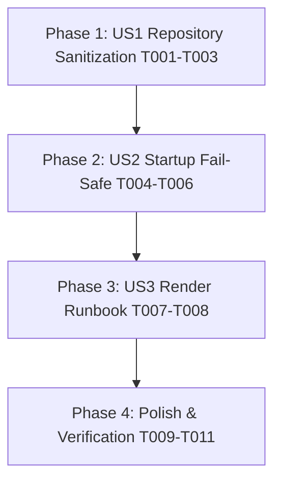

# Tasks: Purge Committed Credentials & Render Secret Remediation

**Feature**: `003-purge-committed-credentials`  
**Input**: [spec.md](spec.md), [plan.md](plan.md), [data-model.md](data-model.md), [contracts/api-contracts.md](contracts/api-contracts.md)  
**Status**: Ready for Implementation

---

## Phase 1: User Story 1 — Repository Sanitization & Git Tracking Elimination (Priority: P1) 🎯 MVP

**Goal**: Permanently remove `backend/.env.render` from repository tracking and expand `.gitignore` so no environment files can be committed.

**Independent Test**: Running `git status` verifies `backend/.env.render` is not tracked, and `git check-ignore backend/.env.render` confirms git ignore rules are active.

- [X] T001 [US1] Remove `backend/.env.render` from git tracking and working tree via git removal command
- [X] T002 [US1] Update root `.gitignore` to include `.env.render`, `*.env.render`, and wildcard `.env.*` while keeping safe template exception `!.env.example`
- [X] T003 [US1] Verify via `git status` and `git check-ignore` that `backend/.env.render` is untracked and ignored

**Checkpoint**: `backend/.env.render` is completely removed from Git tracking and working tree; `.gitignore` blocks re-addition.

---

## Phase 2: User Story 2 — Startup Fail-Safe for Compromised Credentials (Priority: P1)

**Goal**: Reject the leaked Render Postgres password and placeholder JWT secret at startup with fail-fast security exceptions.

**Independent Test**: Running `StartupValidationTests` confirms `StartupValidator.Validate` throws `InvalidOperationException` whenever the exposed password or placeholder JWT key is present.

### Tests for User Story 2 (TDD)
- [X] T004 [P] [US2] Add unit tests in `backend/LinkVaultApi.Tests/Unit/StartupValidationTests.cs` asserting rejection of compromised password `QHMroGZ1oxMou8G7x8qwgwds24Uk7kIg` and leaked placeholder secret `replace_this_with_a_very_long_secure_random_string_for_production`

### Implementation for User Story 2
- [X] T005 [US2] Update `backend/Services/StartupValidator.cs` to add `QHMroGZ1oxMou8G7x8qwgwds24Uk7kIg` to `InsecurePasswords` and `replace_this_with_a_very_long_secure_random_string_for_production` to `InsecurePlaceholders`
- [X] T006 [US2] Run test suite to verify all startup validation tests pass via `dotnet test sharedb1.sln --filter "FullyQualifiedName~StartupValidationTests"`

**Checkpoint**: The backend cannot boot if configured with the leaked database password or leaked JWT placeholder.

---

## Phase 3: User Story 3 — Render Production Secret Rotation & Runbook (Priority: P2)

**Goal**: Document the operator runbook for rotating the live Render database credentials and verifying deployed environment variables.

**Independent Test**: Reviewing the runbook in `README.md` and `quickstart.md` provides unambiguous, step-by-step instructions for resetting credentials in the Render dashboard.

- [X] T007 [P] [US3] Update root `README.md` Security Hardening section documenting the Render Postgres credential rotation requirements and zero-secret environment setup
- [X] T008 [US3] Validate that the runbook in `specs/003-purge-committed-credentials/quickstart.md` details all Render dashboard rotation steps and JWT verification procedures

**Checkpoint**: Production credential rotation runbook is documented and verified.

---

## Phase 4: Polish & Automated Verification

**Purpose**: Full regression testing, verification, and remote push.

- [X] T009 Run complete test suite via `dotnet test sharedb1.sln` ensuring all unit and integration tests pass
- [X] T010 Execute verification scenarios in `specs/003-purge-committed-credentials/quickstart.md`
- [X] T011 Commit sanitized repository state and push to GitHub remote `origin/main`

---

## Dependencies & Execution Order

### User Story Dependencies
- **User Story 1 (P1)**: Independent - can start immediately to purge exposed file from Git.
- **User Story 2 (P1)**: Depends on US1 completion - establishes runtime blacklist for the purged credentials.
- **User Story 3 (P2)**: Depends on US2 - documents operational rotation procedure.
- **Polish**: Final regression tests, quickstart validation, and remote push.

---

## Implementation Strategy

### MVP First (User Story 1 & 2)
1. Delete `backend/.env.render` and update `.gitignore` (immediate VCS protection).
2. Add tests and blacklist in `StartupValidator.cs` (immediate runtime protection).
3. Validate tests pass.
4. Push to remote repository so the public working tree no longer contains the leaked file.
