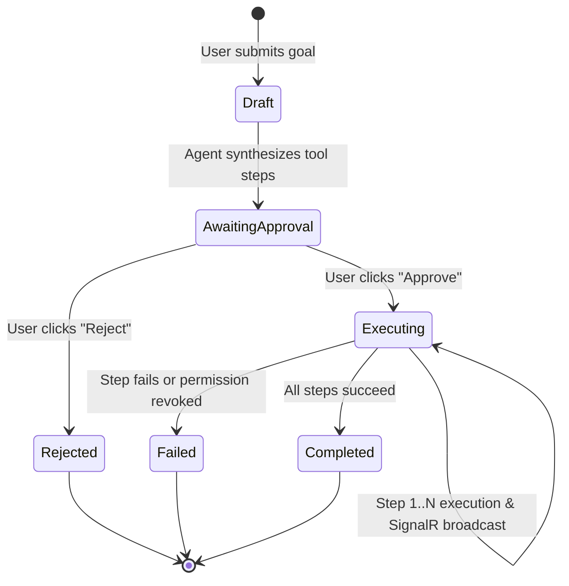

# Data Model: Verifiable Workspace Agent (LinkVault Agent)

**Feature**: `004-verifiable-workspace-agent`  
**Date**: 2026-10-29  
**Status**: Draft  

---

## 1. Domain Entities & Schemas

### 1.1 AgentActionPlan
Represents an autonomous multi-step execution plan generated by the agent based on user instruction.

| Field | Type | Required | Description |
|---|---|---|---|
| `Id` | `Guid` | Yes | Primary Key |
| `OrganizationId` | `Guid` | Yes | Tenant boundary; references `Organization.Id` |
| `UserId` | `Guid` | Yes | Authenticated user requesting the plan; references `User.Id` |
| `UserGoal` | `string` (max 1000) | Yes | Original text or transcribed voice instruction |
| `Status` | `PlanStatus` enum | Yes | `Draft`, `AwaitingApproval`, `Executing`, `Completed`, `Rejected`, `Failed` |
| `Summary` | `string` (max 2000) | No | High-level explanation of the plan synthesized by Llama 3.3 |
| `CreatedAt` | `DateTime` | Yes | Timestamp of creation (UTC) |
| `ApprovedAt` | `DateTime?` | No | Timestamp when user approved the plan |
| `CompletedAt` | `DateTime?` | No | Timestamp of execution completion |
| `ErrorMessage` | `string?` | No | Failure details if execution encountered an error |

### 1.2 PlanStep
Represents an individual atomic tool invocation in the plan.

| Field | Type | Required | Description |
|---|---|---|---|
| `Id` | `Guid` | Yes | Primary Key |
| `PlanId` | `Guid` | Yes | Foreign Key to `AgentActionPlan.Id` |
| `StepNumber` | `int` | Yes | Sequence order (1-indexed) |
| `ToolName` | `string` (max 100) | Yes | e.g., `list_directory`, `move_resource`, `create_directory`, `create_share_link` |
| `ParametersJson` | `string` | Yes | JSON representation of tool arguments |
| `RequiresApproval` | `bool` | Yes | True for state-altering actions (`move`, `share`, `delete`) |
| `Status` | `StepStatus` enum | Yes | `Pending`, `Running`, `Completed`, `Failed`, `Skipped` |
| `ResultJson` | `string?` | No | Tool execution return value (JSON) |
| `ErrorMessage` | `string?` | No | Step-specific error details if failed |
| `StartedAt` | `DateTime?` | No | Timestamp when step execution began |
| `FinishedAt` | `DateTime?` | No | Timestamp when step completed |

### 1.3 SafeShareScan
Represents the security pre-share content scan for credentials, connection strings, and PII.

| Field | Type | Required | Description |
|---|---|---|---|
| `Id` | `Guid` | Yes | Primary Key |
| `ResourceId` | `Guid` | Yes | Target resource scanned; references `Resource.Id` |
| `ScannedByUserId` | `Guid` | Yes | User requesting the share link |
| `Status` | `SafeShareStatus` enum | Yes | `Clean`, `Warning`, `Blocked` |
| `DetectedThreats` | `string` (JSON) | Yes | Array of flagged patterns (e.g. `["PostgresPassword", "ApiKey"]`) |
| `RiskScore` | `int` (0-100) | Yes | Quantitative assessment of sensitive data exposure |
| `ModelVerification`| `string?` | No | Summary from Llama Guard 3 / Llama 3.3 review |
| `ScannedAt` | `DateTime` | Yes | Scan execution timestamp (UTC) |

### 1.4 AuditLog Extension
The existing `AuditLog` entity is enhanced with agent provenance:

| Field | Type | Required | Description |
|---|---|---|---|
| `IsViaAgent` | `bool` | Yes | Default: `false`. Set to `true` when invoked by the agent |
| `AgentPlanId` | `Guid?` | No | Optional linkage to the parent `AgentActionPlan.Id` |
| `AgentToolName`| `string?` (max 100)| No | Tool invoked (e.g., `move_resource`, `create_share_link`) |

---

## 2. Enums

```csharp
public enum PlanStatus
{
    Draft = 0,
    AwaitingApproval = 1,
    Executing = 2,
    Completed = 3,
    Rejected = 4,
    Failed = 5
}

public enum StepStatus
{
    Pending = 0,
    Running = 1,
    Completed = 2,
    Failed = 3,
    Skipped = 4
}

public enum SafeShareStatus
{
    Clean = 0,      // No secrets or PII detected; share proceeds immediately
    Warning = 1,    // Minor PII or non-critical match; requires explicit confirmation
    Blocked = 2     // High-entropy credential or database password detected; creation halted
}
```

---

## 3. State Machine & Transitions


