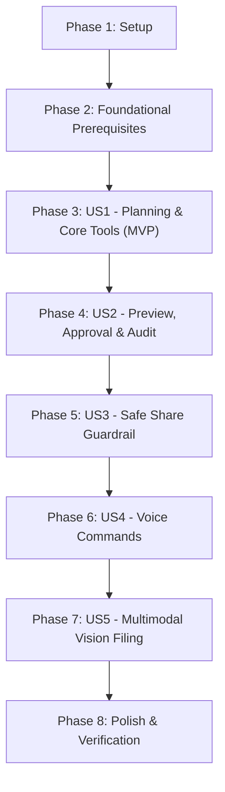

# Tasks: Verifiable Workspace Agent (LinkVault Agent)

**Input**: Design documents from `specs/004-verifiable-workspace-agent/`  
**Prerequisites**: [plan.md](file:///c:/Users/darmu/OneDrive/Attachments/Desktop/LinkVault-main/specs/004-verifiable-workspace-agent/plan.md), [spec.md](file:///c:/Users/darmu/OneDrive/Attachments/Desktop/LinkVault-main/specs/004-verifiable-workspace-agent/spec.md), [research.md](file:///c:/Users/darmu/OneDrive/Attachments/Desktop/LinkVault-main/specs/004-verifiable-workspace-agent/research.md), [data-model.md](file:///c:/Users/darmu/OneDrive/Attachments/Desktop/LinkVault-main/specs/004-verifiable-workspace-agent/data-model.md), [contracts/agent-api.md](file:///c:/Users/darmu/OneDrive/Attachments/Desktop/LinkVault-main/specs/004-verifiable-workspace-agent/contracts/agent-api.md), [quickstart.md](file:///c:/Users/darmu/OneDrive/Attachments/Desktop/LinkVault-main/specs/004-verifiable-workspace-agent/quickstart.md)

**Tests**: Included as unit and contract test tasks preceding or validating service implementations.

**Organization**: Tasks are grouped by user story to enable independent implementation and testing of each story.

## Format: `- [ ] [ID] [P?] [Story] Description with file path`

- **[P]**: Can run in parallel (different files, no dependencies)
- **[Story]**: Which user story this task belongs to (`[US1]`, `[US2]`, `[US3]`, `[US4]`, `[US5]`)
- Every task includes an explicit, unambiguous file path

---

## Phase 1: Setup (Shared Infrastructure)

**Purpose**: Configuration, shared types, and foundation setup.

- [X] T001 Configure Meta Llama provider settings and model defaults (`Llama33Model`, `Llama31Model`, `LlamaVisionModel`, `LlamaGuardModel`, `ApiKey`, `BaseUrl`, `FallbackToLocal`) in backend/Agent/Models/MetaLlamaConfig.cs and wire into backend/appsettings.json
- [X] T002 [P] Define agent TypeScript interfaces (`AgentActionPlanDto`, `PlanStepDto`, `PlanStatus`, `StepStatus`, `SafeShareScanResultDto`, `SafeShareStatus`, `TranscribeResultDto`) in app/src/agent/types/agent.types.ts

---

## Phase 2: Foundational (Blocking Prerequisites)

**Purpose**: Core data models, DbContext registration, SignalR infrastructure, and Meta Llama client required before user story implementation.

**⚠️ CRITICAL**: No user story work can begin until this phase is complete.

- [X] T003 [P] Implement `AgentActionPlan` and `PlanStep` domain entities in backend/Agent/Models/AgentActionPlan.cs and backend/Agent/Models/PlanStep.cs with constraints: `UserGoal` ("string (max 1000), required"), `Status` ("PlanStatus enum: Draft = 0, AwaitingApproval = 1, Executing = 2, Completed = 3, Rejected = 4, Failed = 5"), `Summary` ("string (max 2000), optional"), `StepNumber` ("int, 1-indexed, required"), `ToolName` ("string (max 100), required"), `ParametersJson` ("string, required"), `RequiresApproval` ("bool, required"), and `StepStatus` ("StepStatus enum: Pending = 0, Running = 1, Completed = 2, Failed = 3, Skipped = 4")
- [X] T004 [P] Implement `SafeShareScan` domain entity in backend/Agent/Models/SafeShareScan.cs with constraints: `ResourceId` ("Guid, required"), `ScannedByUserId` ("Guid, required"), `Status` ("SafeShareStatus enum: Clean = 0, Warning = 1, Blocked = 2"), `DetectedThreats` ("string (JSON), required"), `RiskScore` ("int (0-100), required"), and `ScannedAt` ("DateTime, UTC, required")
- [X] T005 [P] Extend `AuditLog` domain entity in backend/Models/AuditLog.cs with fields `IsViaAgent` ("bool, required, default false"), `AgentPlanId` ("Guid?, optional"), and `AgentToolName` ("string? (max 100), optional")
- [X] T006 Register `DbSet<AgentActionPlan>`, `DbSet<PlanStep>`, and `DbSet<SafeShareScan>` in backend/Data/LinkVaultDbContext.cs with entity relationship navigation, cascade delete rules, and foreign key indexes
- [X] T007 [P] Implement request/response DTOs (`CreatePlanRequest`, `AgentPlanResponse`, `PlanStepDto`, `ApprovePlanResponse`, `RejectPlanResponse`, `SafeShareScanRequest`, `SafeShareScanResponse`, `TranscribeResponse`) in backend/Agent/Models/AgentDtos.cs
- [X] T008 Implement `AgentHub` SignalR hub in backend/Agent/Hubs/AgentHub.cs managing connection group `agentPlan_{planId}` and client events (`OnPlanStatusChanged`, `OnStepStarted`, `OnStepCompleted`, `OnStepFailed`, `OnPlanFinished`)
- [X] T009 Implement `IMetaLlamaClient` interface and `MetaLlamaClient` in backend/Agent/Services/IMetaLlamaClient.cs and backend/Agent/Services/MetaLlamaClient.cs providing OpenAI-compatible tool-calling completions for Meta Llama 3.3 (70B Instruct), Llama Guard 3 (8B), and Llama 3.2 Vision (11B) with intelligent fallback
- [X] T010 Register `IMetaLlamaClient`, `IVaultAgentService`, `ISafeShareGuard` services, and map SignalR hub `/hubs/agent` in backend/Program.cs
- [X] T011 [P] Implement SignalR hub connection manager in app/src/agent/services/agentHubClient.ts to join `agentPlan_{planId}` groups and bind live step events
- [X] T012 [P] Implement agent REST API client in app/src/agent/services/agentApi.ts wrapping `/api/agent/plan`, `/api/agent/plan/{id}/approve`, `/api/agent/plan/{id}/reject`, `/api/agent/safe-share/scan`, and `/api/agent/transcribe`

**Checkpoint**: Foundation ready — database entities, API client, SignalR streaming, and Llama inference abstractions established.

---

## Phase 3: User Story 1 - Autonomous Workspace Planning & Tool-Calling Agent Core (Priority: P1) 🎯 MVP

**Goal**: Enable authenticated users to enter high-level workspace directives (e.g., "Organize my loose invoices into an Invoices folder"), synthesize a structured multi-step plan using autonomous workspace tools, and enforce strict tenant and RBAC permission boundaries.

**Independent Test**: Submit a prompt to organize files into a folder. Verify the agent decomposes the goal, searches resources, creates the directory if missing, moves the files, and returns the plan.

### Tests for User Story 1

- [X] T013 [P] [US1] Unit test for agent tool-calling planning loop and workspace actions in backend/LinkVaultApi.Tests/Unit/VaultAgentServiceTests.cs

### Implementation for User Story 1

- [X] T014 [US1] Define `IVaultAgentService` interface with `GeneratePlanAsync` and tool definitions (`list_directory`, `read_file_text`, `search`, `create_directory`, `move_resource`, `create_share_link`) in backend/Agent/Services/IVaultAgentService.cs
- [X] T015 [US1] Implement planning loop in backend/Agent/Services/VaultAgentService.cs using `IMetaLlamaClient` to decompose `UserGoal` into ordered `PlanStep` records with tenant boundary checks (`OrganizationId`) and RBAC validation (`canUpload`, `canUpdate`, `canDelete`, `canShare`)
- [X] T016 [US1] Implement tool execution methods in backend/Agent/Services/VaultAgentService.cs executing read and write operations (`list_directory`, `read_file_text`, `search`, `create_directory`, `move_resource`, `create_share_link`) against `LinkVaultDbContext` and `IStorageProvider`
- [X] T017 [US1] Implement `AgentController` endpoint `POST /api/agent/plan` and plan lookup in backend/Agent/Controllers/AgentController.cs
- [X] T018 [US1] Implement interactive chat prompt and action card in app/src/agent/components/VaultAgentChat.tsx
- [X] T019 [US1] Implement main workspace agent page in app/src/agent/pages/AgentPage.tsx, register route `/agent` in app/src/App.tsx, and add agent navigation entry with Meta badge in app/src/components/layout/ChannelSidebar.tsx

**Checkpoint**: User Story 1 is functional: users can type instructions and receive synthesized, tool-decomposed action plans.

---

## Phase 4: User Story 2 - Plan Preview, One-Click Approval & Verifiable Agent Audit (Priority: P1)

**Goal**: Inspect step-by-step previews of state-altering agent actions, approve or reject with one click, stream execution progress live over SignalR, and record immutable audit entries tagged `via agent`.

**Independent Test**: Trigger a move or share action. Verify execution halts until "Approve" is clicked, steps stream live progress to the UI, and the Audit Log displays the completed actions with `via agent`.

### Tests for User Story 2

- [X] T020 [P] [US2] Unit test for plan approval gating, rejection, and `via agent` audit attribution in backend/LinkVaultApi.Tests/Unit/AgentApprovalAndAuditTests.cs

### Implementation for User Story 2

- [X] T021 [US2] Implement human-in-the-loop approval gating and lifecycle execution in backend/Agent/Services/VaultAgentService.cs requiring explicit approval before running state-altering steps, transitioning `PlanStatus` (`AwaitingApproval` -> `Executing` -> `Completed`/`Failed`), and handling `RejectPlanAsync`
- [X] T022 [US2] Implement real-time progress streaming in backend/Agent/Services/VaultAgentService.cs broadcasting `OnStepStarted`, `OnStepCompleted`, `OnStepFailed`, and `OnPlanFinished` via `IHubContext<AgentHub>`
- [X] T023 [US2] Implement `via agent` audit logging in backend/Agent/Services/VaultAgentService.cs recording all agent tool executions to `AuditLog` with `IsViaAgent = true`, `AgentPlanId`, `AgentToolName`, and `[via agent]` prefix in `Description`
- [X] T024 [US2] Implement `POST /api/agent/plan/{planId}/approve` and `POST /api/agent/plan/{planId}/reject` in backend/Agent/Controllers/AgentController.cs
- [X] T025 [US2] Enhance audit query endpoint in backend/Controllers/AuditController.cs with `isViaAgent` filter parameter and telemetry summary
- [X] T026 [P] [US2] Implement step-by-step plan preview modal with Approve / Reject buttons in app/src/agent/components/PlanPreviewModal.tsx
- [X] T027 [P] [US2] Implement animated real-time progress streamer in app/src/agent/components/LiveProgressStream.tsx
- [X] T028 [P] [US2] Implement `AuditInsightsCard.tsx` in app/src/agent/components/AuditInsightsCard.tsx and enhance app/src/pages/AuditPage.tsx with an "Agent Activity" filter tab and `via agent` badges

**Checkpoint**: User Stories 1 AND 2 are fully integrated: human-in-the-loop verification, live streaming, and verifiable audit records are operational.

---

## Phase 5: User Story 3 - Safe Share Guardrail (Credential & PII Pre-Share Inspection) (Priority: P2)

**Goal**: Automatically scan files for exposed API keys, database passwords, connection strings, and private tokens before share links are generated, blocking link issuance upon detecting sensitive secrets.

**Independent Test**: Ask the agent to share a file containing a test database password or private key. Verify that Safe Share Guard intercepts the share step, flags the secret, and blocks share link creation.

### Tests for User Story 3

- [X] T029 [P] [US3] Unit test for Safe Share secret pattern detection and link blocking in backend/LinkVaultApi.Tests/Unit/SafeShareGuardTests.cs

### Implementation for User Story 3

- [X] T030 [US3] Implement `ISafeShareGuard` interface and `SafeShareGuard` service in backend/Agent/Services/ISafeShareGuard.cs and backend/Agent/Services/SafeShareGuard.cs with two-tier inspection: deterministic regex pattern scanning (`PostgresPassword`, `ApiKey`, `PrivateKey`, `JwtSecret`, `AwsKey`) and Llama Guard 3 model moderation
- [X] T031 [US3] Integrate `SafeShareGuard` check into `create_share_link` tool execution in backend/Agent/Services/VaultAgentService.cs blocking share link creation if `SafeShareStatus == Blocked` and recording scan telemetry to `SafeShareScan`
- [X] T032 [US3] Implement `POST /api/agent/safe-share/scan` endpoint in backend/Agent/Controllers/AgentController.cs
- [X] T033 [P] [US3] Implement pre-share threat alert modal in app/src/agent/components/SafeShareAlertModal.tsx displaying risk scores, detected secret types, and safety recommendations

**Checkpoint**: User Stories 1, 2, and 3 are operational: sharing operations are safely guarded against credential leaks.

---

## Phase 6: User Story 4 - Voice-Driven Workspace Commands (Priority: P3)

**Goal**: Allow users to dictate workspace instructions using their microphone, transcribe speech into actionable agent prompts in real time, and review before execution.

**Independent Test**: Speak "Find presentation uploaded yesterday and share it" into the microphone. Verify speech is transcribed into the prompt input box and submitted to the agent.

### Implementation for User Story 4

- [X] T034 [P] [US4] Implement audio transcription handler in backend/Agent/Services/VaultAgentService.cs and endpoint `POST /api/agent/transcribe` in backend/Agent/Controllers/AgentController.cs supporting multipart audio streams with confidence scoring
- [X] T035 [P] [US4] Implement voice input component in app/src/agent/components/VoiceCommandButton.tsx using browser Web Speech API / MediaRecorder, audio wave visualization, and transcription injection into `VaultAgentChat.tsx`

**Checkpoint**: Hands-free voice directives are fully functional.

---

## Phase 7: User Story 5 - Multimodal Visual Document & Image Categorization (Priority: P4)

**Goal**: Autonomously categorize unorganized image assets (receipts, architecture diagrams, UI mockups) into thematic folders based on visual content analysis with Meta Llama 3.2 Vision.

**Independent Test**: Request the agent to organize images by visual category. Verify image content is analyzed and files are sorted into appropriate semantic directories.

### Implementation for User Story 5

- [X] T036 [P] [US5] Implement multimodal image inspection tool `classify_image` in backend/Agent/Services/VaultAgentService.cs leveraging `IMetaLlamaClient` with Meta Llama 3.2 Vision (11B) to analyze image thumbnails and detect semantic categories (Diagrams, Receipts, Mockups, Documents)
- [X] T037 [US5] Extend planning loop in backend/Agent/Services/VaultAgentService.cs to incorporate visual classification into automated workspace reorganization workflows

**Checkpoint**: All 5 user stories are implemented.

---

## Phase 8: Polish, Verification & Hackathon Showcase

**Purpose**: Hackathon documentation, end-to-end verification, and test suite execution.

- [X] T038 [P] Create root HACKATHON.md documenting: pre-hackathon baseline commit tag (`pre-hackathon`), compare URL (`https://github.com/Musavirdar/LinkVault/compare/pre-hackathon...main`), new agent features, architecture, Meta models used, and security hardening highlights
- [X] T039 Execute full backend test suite (`dotnet test sharedb1.sln`) ensuring all unit, integration, and security tests pass
- [X] T040 Execute frontend build and type check (`npm run build`) ensuring zero compiler or TypeScript errors
- [X] T041 Run quickstart.md validation across all 5 scenarios (Planning, One-Click Approval, Rejection, Safe Share Guard, and Audit Attribution) per specs/004-verifiable-workspace-agent/quickstart.md

---

## Dependencies & Execution Order

### Phase Dependencies



### User Story Dependencies

- **User Story 1 (P1 - MVP)**: Depends on Phase 1 & 2. Delivers the core autonomous planning engine.
- **User Story 2 (P1)**: Depends on US1. Adds approval gating, SignalR live progress streaming, and `via agent` audit logging.
- **User Story 3 (P2)**: Depends on US1 and US2. Intercepts `create_share_link` with regex + Llama Guard 3 scanning.
- **User Story 4 (P3)**: Depends on US1. Adds hands-free voice transcription input into the prompt.
- **User Story 5 (P4)**: Depends on US1. Extends planning loop with Meta Llama 3.2 Vision classification.
- **Phase 8 (Polish)**: Depends on completion of all stories.

### Parallel Opportunities

- **Phase 1**: T001 and T002 can run in parallel.
- **Phase 2**: T003, T004, T005, T007, T011, and T012 can all run in parallel.
- **Phase 3 (US1)**: Test T013 can be authored alongside model and UI tasks (T018, T019).
- **Phase 4 (US2)**: UI components T026, T027, T028 can be implemented in parallel with backend endpoints T024, T025.
- **Phase 5 (US3)**: Test T029 and UI component T033 can be authored in parallel with scanner service T030.
- **Phase 6 & 7**: Voice input (T034, T035) and Multimodal vision (T036, T037) can proceed in parallel.

---

## Parallel Example: User Story 2

```bash
# Launch test and UI components for User Story 2 in parallel:
Task T020: "Unit test for plan approval gating, rejection, and via agent audit attribution in backend/LinkVaultApi.Tests/Unit/AgentApprovalAndAuditTests.cs"
Task T026: "Implement step-by-step plan preview modal in app/src/agent/components/PlanPreviewModal.tsx"
Task T027: "Implement animated real-time progress streamer in app/src/agent/components/LiveProgressStream.tsx"
Task T028: "Implement AuditInsightsCard.tsx and enhance app/src/pages/AuditPage.tsx with Agent Activity filter"
```

---

## Implementation Strategy

### MVP First (User Story 1 & 2)

1. Complete Phase 1 (Setup) and Phase 2 (Foundational prerequisites).
2. Complete Phase 3 (US1: Core Planning and Tool Calling).
3. Complete Phase 4 (US2: Approval Gating, SignalR Streaming, `via agent` Audit).
4. **STOP and VALIDATE**: Verify end-to-end plan generation, human approval, live SignalR progress, and audit records.
5. Deliver MVP.

### Incremental Delivery

1. Phase 1 + 2: Infrastructure established.
2. Phase 3 + 4: Core Verifiable Workspace Agent working end-to-end (MVP).
3. Phase 5: Safe Share Guardrail prevents credential leaks.
4. Phase 6: Voice input allows hands-free control.
5. Phase 7: Multimodal vision sorts visual assets.
6. Phase 8: Comprehensive test suite, HACKATHON.md documentation, and quickstart validation.

