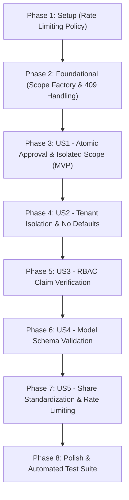

# Tasks: Workspace Agent Security & Concurrency Hardening

**Input**: Design documents from `specs/005-harden-workspace-agent/`  
**Prerequisites**: [plan.md](file:///c:/Users/darmu/OneDrive/Attachments/Desktop/LinkVault-main/specs/005-harden-workspace-agent/plan.md), [spec.md](file:///c:/Users/darmu/OneDrive/Attachments/Desktop/LinkVault-main/specs/005-harden-workspace-agent/spec.md), [research.md](file:///c:/Users/darmu/OneDrive/Attachments/Desktop/LinkVault-main/specs/005-harden-workspace-agent/research.md), [data-model.md](file:///c:/Users/darmu/OneDrive/Attachments/Desktop/LinkVault-main/specs/005-harden-workspace-agent/data-model.md), [contracts/agent-api.md](file:///c:/Users/darmu/OneDrive/Attachments/Desktop/LinkVault-main/specs/005-harden-workspace-agent/contracts/agent-api.md), [quickstart.md](file:///c:/Users/darmu/OneDrive/Attachments/Desktop/LinkVault-main/specs/005-harden-workspace-agent/quickstart.md)

**Tests**: Includes automated unit tests verifying double approval 409 conflict, unauthorized approval denial, Viewer claim denials, missing resource IDs, and cross-tenant entity boundaries.

**Organization**: Tasks are grouped by user story to enable independent implementation and testing of each story.

## Format: `- [ ] [ID] [P?] [Story] Description with file path`

- **[P]**: Can run in parallel (different files, no dependencies)
- **[Story]**: Which user story this task belongs to (`[US1]`, `[US2]`, `[US3]`, `[US4]`, `[US5]`)
- Every task includes an explicit, unambiguous file path

---

## Phase 1: Setup (Shared Infrastructure)

**Purpose**: Register rate limiting policy for agent endpoints.

- [X] T001 Register `agent_plan` rate limiter policy in backend/Program.cs configured for per-user partitioned rate limiting at 10 requests per minute with status 429 and `Retry-After: 60`

---

## Phase 2: Foundational (Blocking Prerequisites)

**Purpose**: Core dependency injection refactoring and error handling prerequisites.

**⚠️ CRITICAL**: No user story work can begin until this phase is complete.

- [X] T002 Inject `IServiceScopeFactory` into backend/Agent/Services/VaultAgentService.cs and refactor constructor and field definitions to support isolated background scope generation
- [X] T003 [P] Update `AgentController.cs` error handling in backend/Agent/Controllers/AgentController.cs to catch `InvalidOperationException` and return `StatusCodes.Status409Conflict` with message `{"error": ex.Message}`

**Checkpoint**: Foundation ready — rate limiter configured, service scope factory available, and HTTP 409 response handler wired.

---

## Phase 3: User Story 1 - Concurrency-Safe Isolated Background Execution & Atomic Plan Gating (Priority: P1) 🎯 MVP

**Goal**: Make agent plan approvals and rejections atomic at the database level and isolate background step execution inside a dedicated service scope.

**Independent Test**: Send concurrent duplicate approval requests; verify exactly one succeeds and the other returns HTTP 409 Conflict. Background steps execute to completion without request lifecycle exceptions.

### Tests for User Story 1

- [X] T004 [P] [US1] Unit test for atomic approval (double approval returns 409) and ownership gating in backend/LinkVaultApi.Tests/Unit/AgentHardeningTests.cs

### Implementation for User Story 1

- [X] T005 [US1] Implement atomic conditional approval in `ApprovePlanAsync` in backend/Agent/Services/VaultAgentService.cs using `ExecuteUpdateAsync` where `Id == planId && OrganizationId == orgId && Status == PlanStatus.AwaitingApproval`, throwing `InvalidOperationException` when 0 rows are affected
- [X] T006 [US1] Refactor background execution dispatch in `ApprovePlanAsync` in backend/Agent/Services/VaultAgentService.cs to create an isolated scope (`_scopeFactory.CreateScope()`), resolve fresh scoped services (`LinkVaultDbContext`, `IHubContext<AgentHub>`, `ISafeShareGuard`, `IStorageProvider`), remove `using var scope = _dbContext`, and execute steps in the background scope
- [X] T007 [US1] Implement atomic conditional rejection in `RejectPlanAsync` in backend/Agent/Services/VaultAgentService.cs validating plan ownership or Admin role, atomically updating status to `Rejected` where `Status == PlanStatus.AwaitingApproval`, and setting pending steps to `Skipped`

**Checkpoint**: User Story 1 is functional: plan state transitions are atomic, and background tasks run in independent service scopes.

---

## Phase 4: User Story 2 - Zero-Trust Tenant Isolation & Removal of Unsafe Defaults (Priority: P1)

**Goal**: Remove all arbitrary entity fallbacks (never pick "first resource") and verify all referenced resource and directory IDs belong to the caller's organization.

**Independent Test**: Call `move_resource` with a missing resource ID or an ID belonging to another organization. The step immediately fails without modifying any workspace files.

### Tests for User Story 2

- [X] T008 [P] [US2] Unit test for missing resource ID and cross-tenant entity access rejection in backend/LinkVaultApi.Tests/Unit/AgentHardeningTests.cs

### Implementation for User Story 2

- [X] T009 [US2] Remove unsafe first-resource fallback and enforce tenant isolation in `move_resource` in backend/Agent/Services/VaultAgentService.cs, failing the step if `resourceId` is missing/empty, or if `resourceId` or `targetDirectoryId` does not belong to caller's `OrganizationId`
- [X] T010 [US2] Enforce tenant boundary checks in `create_directory` in backend/Agent/Services/VaultAgentService.cs, failing the step if `parentDirectoryId` is specified but does not belong to caller's `OrganizationId`

**Checkpoint**: User Stories 1 AND 2 are complete: tenant boundaries are strictly enforced with zero default fallbacks.

---

## Phase 5: User Story 3 - Role-Based Claim Verification for Agent Tools (Priority: P1)

**Goal**: Inspect caller claims before executing state-altering tools, blocking unauthorized roles (such as Viewers) from modifying resources.

**Independent Test**: Execute tools as a Viewer; verify that `create_directory`, `move_resource`, and `create_share_link` fail with informative claim permission errors.

### Tests for User Story 3

- [X] T011 [P] [US3] Unit test for Viewer role claim denials on `create_directory`, `move_resource`, and `create_share_link` in backend/LinkVaultApi.Tests/Unit/AgentHardeningTests.cs

### Implementation for User Story 3

- [X] T012 [US3] Implement caller claim inspection in backend/Agent/Services/VaultAgentService.cs before state-altering tools: verify `canUpload` for `create_directory`, `canUpdate` for `move_resource`, `canShare` for `create_share_link`, and `canDelete` for `delete_resource`, failing the step if the claim is false and user is not an Admin

**Checkpoint**: User Story 3 complete: full RBAC claim enforcement active on all state-altering agent tools.

---

## Phase 6: User Story 4 - Robust Model Schema Validation & Plan Length Boundaries (Priority: P2)

**Goal**: Validate tool arguments with `TryGetProperty` against per-tool schemas, reject malformed plans before saving, and enforce a 10-step plan maximum.

**Independent Test**: Feed malformed tool parameters or a plan with > 10 steps to the planning loop; verify the whole plan is rejected upfront.

### Tests for User Story 4

- [X] T013 [P] [US4] Unit test for tool argument schema validation with `TryGetProperty` and 10-step plan capping in backend/LinkVaultApi.Tests/Unit/AgentHardeningTests.cs

### Implementation for User Story 4

- [X] T014 [US4] Implement per-tool schema validation with `TryGetProperty` in backend/Agent/Services/MetaLlamaClient.cs and backend/Agent/Services/VaultAgentService.cs, rejecting the entire plan if any tool argument is invalid
- [X] T015 [US4] Enforce maximum 10-step plan cap in backend/Agent/Services/MetaLlamaClient.cs and backend/Agent/Services/VaultAgentService.cs

**Checkpoint**: User Story 4 complete: malformed model outputs rejected and plan sizes strictly bounded.

---

## Phase 7: User Story 5 - Standardized Share Link Creation & Rate Limiting Endpoint Integration (Priority: P2)

**Goal**: Standardize `create_share_link` logic to match `ShareController` and apply rate limiting to `POST /api/agent/plan`.

**Independent Test**: Verify generated share links include `OrganizationId`, secure tokens, and expiration dates. Verify exceeding 10 plan requests per minute triggers HTTP 429.

### Implementation for User Story 5

- [X] T016 [US5] Standardize `create_share_link` in backend/Agent/Services/VaultAgentService.cs to assign `OrganizationId = orgId`, secure token generation, expiration date, optional password hashing, and download limit matching `ShareController`
- [X] T017 [US5] Apply `[EnableRateLimiting("agent_plan")]` attribute to `POST /api/agent/plan` in backend/Agent/Controllers/AgentController.cs

**Checkpoint**: All 5 user stories complete: sharing standardized and endpoints rate-limited.

---

## Phase 8: Polish, Test Suite Execution & Quickstart Validation

**Purpose**: Comprehensive test suite execution and validation of all hardening scenarios.

- [X] T018 Execute full unit and integration test suite (`dotnet test backend/LinkVaultApi.Tests/LinkVaultApi.Tests.csproj`) verifying all 5 security test cases pass (double approval, foreign plan approval, Viewer move/share, missing resourceId, cross-org resource)
- [X] T019 Run quickstart.md validation across all 5 hardening scenarios per specs/005-harden-workspace-agent/quickstart.md

---

## Dependencies & Execution Order

### Phase Dependencies



### User Story Dependencies

- **User Story 1 (P1 - MVP)**: Depends on Phase 1 & 2. Delivers atomic approvals and isolated scopes.
- **User Story 2 (P1)**: Depends on US1. Eliminates unsafe defaults and cross-tenant entity access.
- **User Story 3 (P1)**: Depends on US2. Gates tools with user RBAC claims (`canUpload`, `canUpdate`, `canShare`, `canDelete`).
- **User Story 4 (P2)**: Depends on US1. Adds schema validation and 10-step cap.
- **User Story 5 (P2)**: Depends on US2 & US3. Standardizes share link creation and applies rate limiting attribute.
- **Phase 8 (Polish)**: Depends on all user stories being complete.

---

## Parallel Example: User Stories 1, 2 & 3 Tests

```bash
# Launch unit tests for US1, US2, and US3 together:
Task T004: "Unit test for atomic approval (double approval returns 409) and ownership gating in backend/LinkVaultApi.Tests/Unit/AgentHardeningTests.cs"
Task T008: "Unit test for missing resource ID and cross-tenant entity access rejection in backend/LinkVaultApi.Tests/Unit/AgentHardeningTests.cs"
Task T011: "Unit test for Viewer role claim denials on create_directory, move_resource, and create_share_link in backend/LinkVaultApi.Tests/Unit/AgentHardeningTests.cs"
```

---

## Implementation Strategy

### MVP First (User Story 1 Only)

1. Complete Phase 1: Setup (`agent_plan` rate limit policy).
2. Complete Phase 2: Foundational (`IServiceScopeFactory` injection & 409 error mapping).
3. Complete Phase 3: User Story 1 (Atomic `ExecuteUpdateAsync` approval & isolated background execution).
4. **STOP and VALIDATE**: Verify atomic double approval 409 and background scope execution.

### Incremental Delivery

1. Phase 1 + 2: Foundational infrastructure ready.
2. Phase 3: Atomic approval and isolated execution scope (MVP).
3. Phase 4: Zero-trust tenant isolation with no unsafe defaults.
4. Phase 5: RBAC claim verification before each state-changing tool.
5. Phase 6: Model output schema validation and 10-step plan cap.
6. Phase 7: Standardized share link generation and rate limiting.
7. Phase 8: Full automated test suite verification.

