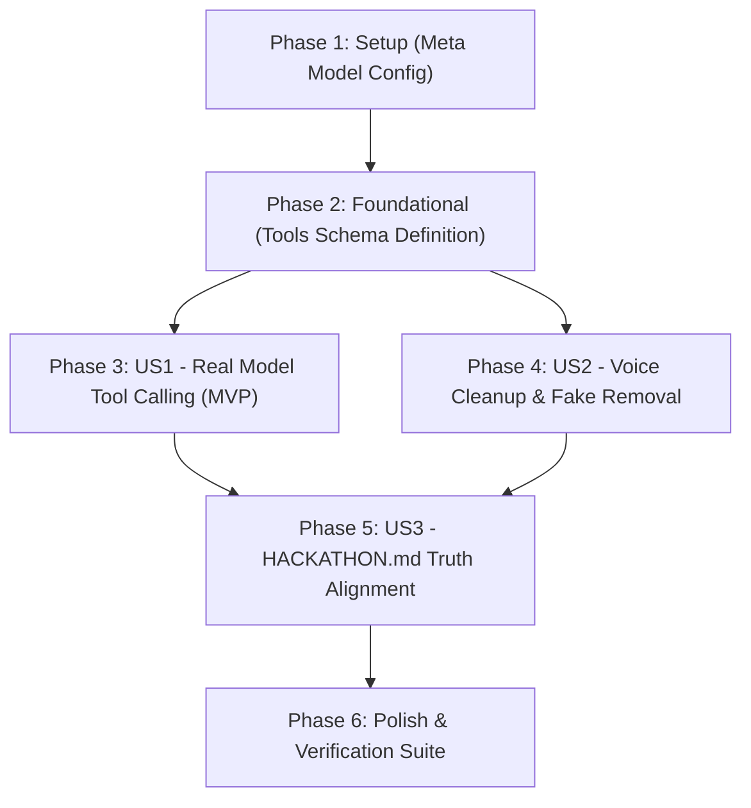

# Tasks: Meta Model API Integration, Tool Calling Specification & Submission Integrity

**Input**: Design documents from `specs/006-meta-models-and-tool-calling/`  
**Prerequisites**: [plan.md](file:///c:/Users/darmu/OneDrive/Attachments/Desktop/LinkVault-main/specs/006-meta-models-and-tool-calling/plan.md), [spec.md](file:///c:/Users/darmu/OneDrive/Attachments/Desktop/LinkVault-main/specs/006-meta-models-and-tool-calling/spec.md), [research.md](file:///c:/Users/darmu/OneDrive/Attachments/Desktop/LinkVault-main/specs/006-meta-models-and-tool-calling/research.md), [data-model.md](file:///c:/Users/darmu/OneDrive/Attachments/Desktop/LinkVault-main/specs/006-meta-models-and-tool-calling/data-model.md), [contracts/agent-api.md](file:///c:/Users/darmu/OneDrive/Attachments/Desktop/LinkVault-main/specs/006-meta-models-and-tool-calling/contracts/agent-api.md), [quickstart.md](file:///c:/Users/darmu/OneDrive/Attachments/Desktop/LinkVault-main/specs/006-meta-models-and-tool-calling/quickstart.md)

**Tests**: Includes automated unit tests verifying the formal `tools` request payload structure, remote `tool_calls` parsing, offline fallback behavior, and absence of fake transcription endpoints.

**Organization**: Tasks are grouped by user story to enable independent implementation and testing of each story.

## Format: `- [ ] [ID] [P?] [Story] Description with file path`

- **[P]**: Can run in parallel (different files, no dependencies)
- **[Story]**: Which user story this task belongs to (`[US1]`, `[US2]`, `[US3]`, `[US4]`)
- Every task includes an explicit, unambiguous file path

---

## Phase 1: Setup & Configuration (Meta Model Endpoints & Models)

**Purpose**: Configure Meta hackathon model endpoints and environment variables.

- [X] T001 Configure Meta Model API / Baseten endpoint defaults and model identifiers in backend/appsettings.json and backend/Agent/Models/MetaLlamaConfig.cs supporting `META_MODEL_BASE_URL`, `META_MODEL_API_KEY`, `BASETEN_API_KEY`, and `META_MODEL_NAME`

---

## Phase 2: Foundational (Blocking Prerequisites)

**Purpose**: Core tool definition schema building blocks for completions requests.

**⚠️ CRITICAL**: Must be in place before remote tool calling is wired.

- [X] T002 Implement formal `GetWorkspaceToolsDefinition()` helper in backend/Agent/Services/MetaLlamaClient.cs returning standard OpenAI/Meta function calling schemas for `create_directory`, `move_resource`, `create_share_link`, `search`, `list_directory`, and `delete_resource`

**Checkpoint**: Tool schema foundation ready.

---

## Phase 3: User Story 1 - Real Autonomous Tool Calling via Meta Model API (Priority: P1) 🎯 MVP

**Goal**: Deliver genuine Meta model autonomous tool calling by sending formal tool schemas with `"tool_choice": "auto"` and parsing model `tool_calls` into executable plan steps.

**Independent Test**: Send a multi-step user goal to `GenerateToolPlanAsync` with a mock or live completions endpoint; verify the request contains the `tools` array and extracts the model's `tool_calls` into plan steps without hitting the local fallback.

### Tests for User Story 1

- [X] T003 [P] [US1] Unit test for formal `tools` completions request payload generation and remote `tool_calls` parsing in backend/LinkVaultApi.Tests/Unit/MetaModelToolCallingTests.cs

### Implementation for User Story 1

- [X] T004 [US1] Update `GenerateToolPlanAsync` in backend/Agent/Services/MetaLlamaClient.cs to include the `tools` definition array and `"tool_choice": "auto"` in `requestBody`, and extract assistant `tool_calls` from `choice.message.tool_calls`
- [X] T005 [US1] Ensure `GenerateLocalFallbackPlan` in backend/Agent/Services/MetaLlamaClient.cs operates strictly as an offline or network error fallback with appropriate diagnostic warning logs

**Checkpoint**: User Story 1 is functional: Meta model tool calling is genuine and verified.

---

## Phase 4: User Story 2 - Native Browser Voice Command Integrity (Priority: P1)

**Goal**: Eliminate the fake backend speech mock endpoint and rely purely on browser Web Speech API for voice dictation.

**Independent Test**: Inspect API routes to confirm `/api/agent/transcribe` returns 404; click microphone button in frontend and verify actual speech populates the prompt box without calling any mock audio upload endpoint.

### Implementation for User Story 2

- [X] T006 [P] [US2] Remove fake `/api/agent/transcribe` endpoint and `TranscribeResponse` DTO from backend/Agent/Controllers/AgentController.cs and backend/Agent/Models/AgentDtos.cs
- [X] T007 [US2] Remove `TranscribeAudioAsync` method declaration and implementation from backend/Agent/Services/IVaultAgentService.cs and backend/Agent/Services/VaultAgentService.cs
- [X] T008 [P] [US2] Refactor app/src/agent/components/VoiceCommandButton.tsx and app/src/agent/services/agentApi.ts to rely exclusively on native browser `SpeechRecognition` / `webkitSpeechRecognition`, removing fake audio blob POST fallback and displaying user-friendly notifications when unsupported

**Checkpoint**: User Story 2 complete: fake audio transcription deleted and voice relies authentically on native browser speech.

---

## Phase 5: User Story 3 - Hackathon Submission Honesty & Baseline Transparency (Priority: P1)

**Goal**: Align `HACKATHON.md` with verifiable reality regarding baseline dates, event work, git history, and download ticket endpoints.

**Independent Test**: Review `HACKATHON.md` line by line against repository history, git tags, and file routes to verify all statements are factual.

### Implementation for User Story 3

- [X] T009 [US3] Rewrite baseline section in HACKATHON.md to honestly state that the pre-hackathon baseline was the foundational LinkVault web app prior to Oct 26, and clearly attribute security hardening (download tickets, path traversal fixes, proxy headers, credential purge) to the Oct 27–29 hackathon period
- [X] T010 [US3] Remove the inaccurate "all commits are untampered" statement from HACKATHON.md and transparently document the repository history and force-push context
- [X] T011 [US3] Correct the download ticket route in HACKATHON.md to `POST /api/files/{id}/ticket` (issued) and `GET /api/files/{id}/download?ticket={token}` (streamed)
- [X] T012 [US3] Update the model table and headline in HACKATHON.md to accurately describe active Meta models (Meta Model API / Baseten endpoints), Llama 3.3 70B tool calling, and local fallback mechanics

**Checkpoint**: User Story 3 complete: `HACKATHON.md` is 100% factual and compliant with hackathon submission integrity rules.

---

## Phase 6: Polish, Automated Test Suite & Quickstart Validation

**Purpose**: Full automated regression testing, frontend compilation check, and quickstart scenario verification.

- [X] T013 Execute full unit test suite (`dotnet test backend/LinkVaultApi.Tests/LinkVaultApi.Tests.csproj`) verifying all existing (56 tests) and new tool-calling unit tests pass with zero failures
- [X] T014 Execute frontend build (`npm run build` in `app/`) to verify TypeScript bundle compiles with zero errors
- [X] T015 Validate quickstart scenarios across tool calling, voice dictation, and documentation integrity per specs/006-meta-models-and-tool-calling/quickstart.md

---

## Dependencies & Execution Order

### Phase Dependencies

### User Story Dependencies

- **User Story 1 (P1 - MVP)**: Depends on Phase 1 & 2. Delivers formal `tools` request payload and `tool_calls` response parsing.
- **User Story 2 (P1)**: Independent of US1. Deletes mock backend transcription and relies on native browser recognition.
- **User Story 3 (P1)**: Depends on US1 & US2 to reflect the actual verified state of the codebase.
- **Phase 6 (Polish)**: Runs after all user stories are complete.

