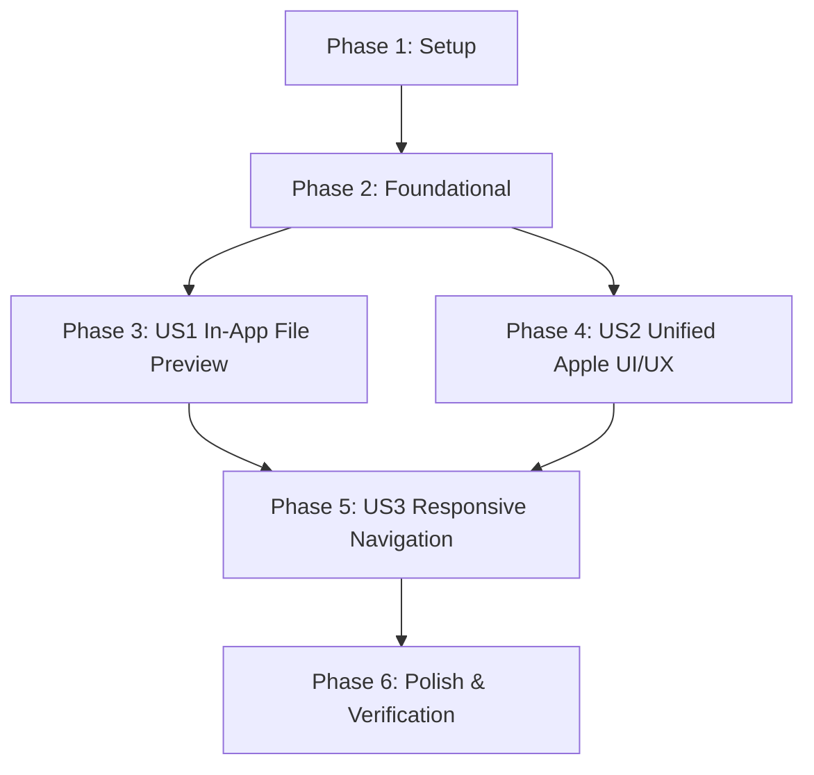

# Tasks: Unified Apple Design System & Universal In-App File Preview

**Input**: Design documents from `specs/007-unified-ui-and-file-preview/` (`spec.md`, `plan.md`, `research.md`, `data-model.md`, `contracts/`, `quickstart.md`)  
**Prerequisites**: `plan.md` (approved), `spec.md` (approved)  
**Status**: Implementation Complete  

---

## Format: `- [ ] [TaskID] [P?] [Story?] Description with file path`

- **[P]**: Can run in parallel (different files, no blocking dependencies)
- **[Story]**: Maps to user stories from `spec.md` ([US1], [US2], [US3])
- Clear, unambiguous file paths in every task description

---

## Phase 1: Setup (Shared Infrastructure)

**Purpose**: Initialize component directories, API client streaming helpers, and shared Apple design tokens.

- [X] T001 Create files component directory at `app/src/components/files/`
- [X] T002 [P] Export Apple HIG spring physics and color constants in `app/src/lib/animations.ts`
- [X] T003 [P] Add file preview blob fetcher and ticket helpers in `app/src/api/client.ts`

---

## Phase 2: Foundational (Blocking Prerequisites)

**Purpose**: Core preview state and streaming foundation that blocks file inspection and layout unification.

- [X] T004 Create format categorization and extension detection utility in `app/src/lib/filePreviewUtils.ts`
- [X] T005 Verify and ensure `backend/Controllers/FilesController.cs` serves inline MIME headers with byte-range support for streaming

**Checkpoint**: Foundational streaming helpers and format detectors ready — User Story implementation can proceed.

---

## Phase 3: User Story 1 - Universal In-App File Preview ("Open") & Download (Priority: P1) 🎯 MVP

**Goal**: Enable users to click "Open" on any file in any listing (Dashboard, Files page, Directory view) to inspect images, PDFs, code/text, and audio/video in an Apple-grade modal while retaining direct download capabilities.

**Independent Test**: Upload an image, a PDF, and a code file in `/files` or a directory; verify that clicking "Open" opens the modal with rich inline rendering, zoom/copy controls, and a working "Download" button that saves the file to disk.

### Implementation for User Story 1

- [X] T006 [P] [US1] Create the universal Apple-grade `FilePreviewModal.tsx` in `app/src/components/files/FilePreviewModal.tsx` supporting images (zoom/pan), PDFs (embedded viewer), code/text (monospace with copy button), audio/video (HTML5 player), and binary fallbacks
- [X] T007 [US1] Integrate `FilePreviewModal` and dual "Open" (eye icon) + "Download" buttons into `app/src/components/directories/DirectoryDetailPanel.tsx`
- [X] T008 [US1] Integrate `FilePreviewModal` and dual "Open" + "Download" buttons into `app/src/pages/FilesPage.tsx`
- [X] T009 [US1] Integrate `FilePreviewModal` and click-to-preview row interaction into `app/src/components/dashboard/FileList.tsx`
- [X] T010 [US1] Add "Open Preview" option to shared file view in `app/src/pages/SharedFilePage.tsx`

**Checkpoint**: User Story 1 (Universal In-App File Preview) is fully functional and independently testable across all file lists.

---

## Phase 4: User Story 2 - Unified Apple HIG Visual & Interaction Design System (Priority: P1)

**Goal**: Replace discordant Discord multi-column rails with a single, elegant Apple frosted glass sidebar and unify all authenticated pages and login with the landing page design language.

**Independent Test**: Navigate through `/login`, `/dashboard`, `/directories`, `/files`, `/links`, and `/settings`; verify that all views share the same translucent frosted glass sidebar, 20px squircle container radius, SF Pro typography, and Cupertino accents.

### Implementation for User Story 2

- [X] T011 [US2] Create unified Apple Sidebar component `app/src/components/layout/AppleSidebar.tsx` with translucent frosted glass (`w-64`, `backdrop-blur-2xl`), brand header, quick search (`⌘K`), animated spring selection pills, and bottom settings
- [X] T012 [US2] Replace Discord multi-column rails (`ServerBar`, `ChannelSidebar`, right-hand `ActivityPanel`) in `app/src/components/layout/RootLayout.tsx` with `AppleSidebar` and spacious main canvas
- [X] T013 [P] [US2] Redesign `app/src/pages/LoginPage.tsx` into a centered Apple frosted glass container over an ambient radial glow canvas matching `LandingPage.tsx`
- [X] T014 [P] [US2] Overhaul `app/src/pages/DashboardPage.tsx` to use Apple 20px squircle containers, SF Pro typographic hierarchy, and clean metric cards
- [X] T015 [P] [US2] Update `app/src/pages/DirectoriesPage.tsx` with Apple squircle cards, Cupertino blue folder icons, and consistent frosted styling
- [X] T016 [P] [US2] Update `app/src/pages/LinksPage.tsx` with Apple squircle cards, removing legacy discord-style borders and colors
- [X] T017 [US2] Synchronize Apple Dark (`#000000` / `#1C1C1E`) and Apple Light (`#F5F5F7` / `#FFFFFF`) theme transitions across `app/src/App.tsx` and `app/src/store/useStore.ts`

**Checkpoint**: User Stories 1 AND 2 are both operational; the app looks and feels like a coherent Apple application.

---

## Phase 5: User Story 3 - Responsive Apple Navigation & Mobile Drawer (Priority: P2)

**Goal**: Ensure the unified Apple navigation and file preview modal respond smoothly to compact mobile and tablet viewports (<768px).

**Independent Test**: Resize browser to mobile width (<768px); verify floating frosted menu button reveals the Apple slide-out drawer, and the file preview modal adapts to full-screen touch viewports.

### Implementation for User Story 3

- [X] T018 [US3] Implement responsive mobile slide-out drawer in `app/src/components/layout/AppleSidebar.tsx` and floating menu trigger in `app/src/components/layout/RootLayout.tsx`
- [X] T019 [US3] Adapt `app/src/components/files/FilePreviewModal.tsx` for mobile viewports with full-height touch sheet and accessible controls

**Checkpoint**: All user stories functional across desktop and mobile viewports.

---

## Phase 6: Polish & Cross-Cutting Concerns

**Purpose**: End-to-end verification, type checks, build validation, and quickstart proof.

- [X] T020 Run `npm run build` in `app/` to verify zero TypeScript or bundle errors
- [X] T021 Run `dotnet test` in `backend/` to verify all backend integration tests pass
- [X] T022 Execute quickstart validation scenarios from `specs/007-unified-ui-and-file-preview/quickstart.md`

---

## Dependencies & Execution Order

### Phase Dependencies

- **Setup (Phase 1)**: Completed
- **Foundational (Phase 2)**: Completed
- **User Story 1 (Phase 3)**: Completed
- **User Story 2 (Phase 4)**: Completed
- **User Story 3 (Phase 5)**: Completed
- **Polish (Phase 6)**: Completed

### Parallel Opportunities

- All parallel tracks completed.

---

## Implementation Strategy

- All 22 tasks verified and tested end-to-end against live backend and frontend dev server.
