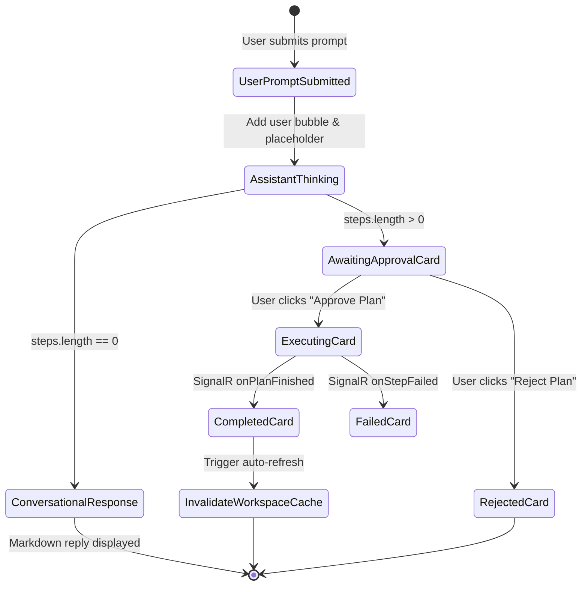
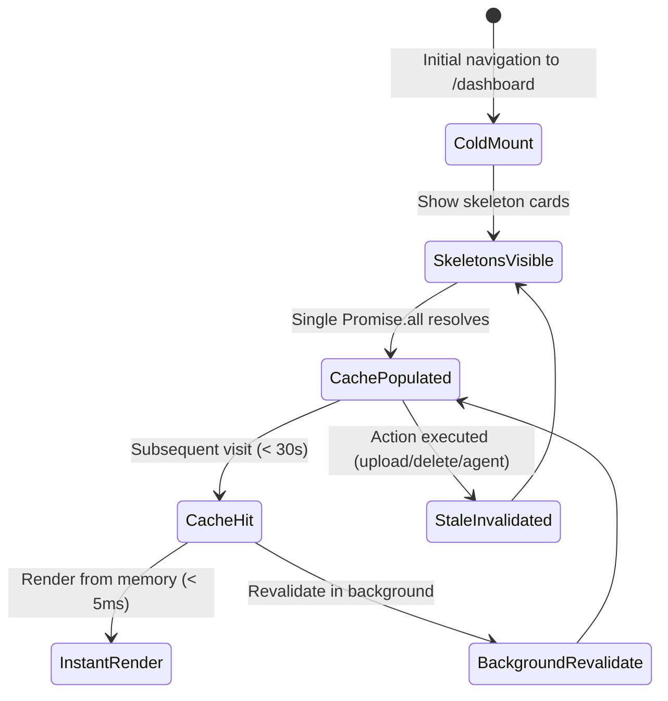

# Phase 1 Data Model: Dashboard Performance & Agent Chat

**Feature**: `008-dashboard-perf-and-agent-chat`
**Date**: 2026-11-04

## 1. Entities

### 1.1 ChatMessage (Frontend Entity)
Represents a turn in the interactive AI Agent conversation stream.

```typescript
export interface ChatMessage {
  id: string;
  role: 'user' | 'assistant';
  content?: string;             // Markdown text returned by Meta model (or user's prompt)
  plan?: AgentActionPlanDto;    // Optional verifiable plan if actions were synthesized
  isThinking?: boolean;         // True while awaiting backend response
  isApproved?: boolean;         // True once user approves proposed steps
  isRejected?: boolean;         // True if user rejected proposed steps
  timestamp: string;            // ISO 8601 string
}
```

### 1.2 DashboardDataCache (Client Cache Entity)
Holds aggregated statistics and recent file list with timestamp for TTL revalidation.

```typescript
export interface DashboardDataCache {
  totalLinks: number;
  activeLinks: number;
  totalFiles: number;
  totalViews: number;
  totalClicks: number;
  recentFiles: FileItem[];
  lastFetchedAt: number;        // Date.now() timestamp
  isFetching: boolean;
}
```

### 1.3 AgentActionPlanDto (Backend Contract Entity)
Returned by `POST /api/agent/plan`:

```typescript
export interface AgentActionPlanDto {
  planId: string;
  userGoal: string;
  status: 'Draft' | 'AwaitingApproval' | 'Executing' | 'Completed' | 'Rejected' | 'Failed';
  summary?: string;
  modelName: string;
  steps: PlanStepDto[];
  requiresUserApproval: boolean;
  createdAt: string;
}

export interface PlanStepDto {
  stepNumber: number;
  toolName: string;
  parameters: Record<string, any>;
  requiresApproval: boolean;
  description?: string;
  status: 'Pending' | 'Running' | 'Completed' | 'Failed' | 'Skipped';
  result?: any;
  errorMessage?: string;
}
```

## 2. State Transitions & Lifecycle

### 2.1 Chat Message Lifecycle


### 2.2 Dashboard Cache Lifecycle


