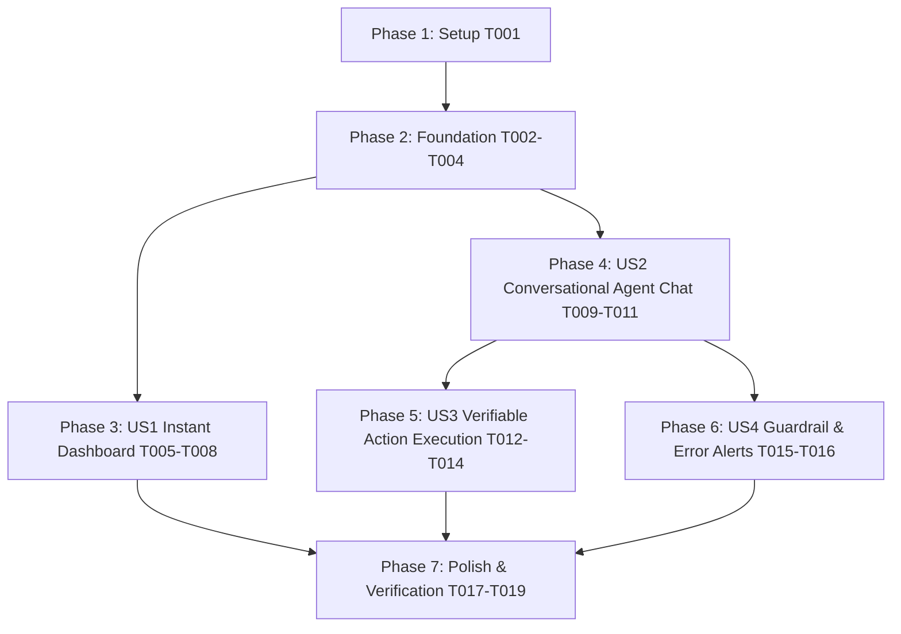

# Tasks: Dashboard Performance & Conversational AI Agent Chat

**Input**: Design documents from `specs/008-dashboard-perf-and-agent-chat/`
**Prerequisites**: `plan.md`, `spec.md`, `research.md`, `data-model.md`, `contracts/`, `quickstart.md`

## Format: `[ID] [P?] [Story] Description`
- **[P]**: Can run in parallel (different files, no dependencies)
- **[Story]**: User story identifier (US1, US2, US3, US4)
- Include exact file paths in descriptions

---

## Phase 1: Setup (Shared Infrastructure)

- [x] T001 Verify existing build and test suites pass cleanly via `npm run build` in `app/` and `dotnet test --no-build` in `backend/`.

---

## Phase 2: Foundational (Blocking Prerequisites)

**Purpose**: Core client cache and message entity structures required by all user stories

- [x] T002 [P] Implement consolidated dashboard hook `useDashboardData.ts` with in-memory caching and 30s TTL in `app/src/hooks/useDashboardData.ts`.
- [x] T003 [P] Extend agent types with `ChatMessage` and approval states in `app/src/agent/types/agent.types.ts`.
- [x] T004 [P] Create reusable shimmer skeleton components in `app/src/components/dashboard/DashboardSkeleton.tsx`.

---

## Phase 3: User Story 1 - Instant & Responsive Dashboard (Priority: P1) 🎯 MVP

**Goal**: Eliminate artificial delays and duplicate network queries, delivering instant dashboard loading and smooth file lists.

**Independent Test**: Navigate to `/dashboard` from sidebar; verify page renders in < 300ms, skeletons display on cold load, and recent files list interacts smoothly without jank.

- [x] T005 [P] [US1] Remove artificial animation delay (`delay: 0.2s`, `duration: 0.4s` → `duration: 0.15s`, `delay: 0s`) in `app/src/components/layout/MainCanvas.tsx`.
- [x] T006 [P] [US1] Update `app/src/components/dashboard/FileList.tsx` to support loading skeletons and replace `motion.tr` layout recalculation with CSS transitions.
- [x] T007 [P] [US1] Update `app/src/components/dashboard/StatsGrid.tsx` with shimmer skeleton support during loading.
- [x] T008 [US1] Integrate `useDashboardData` into `app/src/pages/DashboardPage.tsx` to consolidate requests and render cached recent files immediately.

---

## Phase 4: User Story 2 - Conversational AI Agent Chat & Immediate Responses (Priority: P1) 🎯 MVP

**Goal**: Render an interactive chat feed where user prompts and assistant markdown replies (including "hello" and queries) are displayed immediately.

**Independent Test**: Type "hello" into the agent prompt box and press Enter; verify user bubble appears, typing status displays, and the assistant's formatted markdown response renders in the conversation feed.

- [x] T009 [P] [US2] Create `AgentMessageBubble.tsx` in `app/src/agent/components/AgentMessageBubble.tsx` with markdown rendering (headings, bullet points, code blocks) and avatar badges.
- [x] T010 [P] [US2] Update `VaultAgentChat.tsx` in `app/src/agent/components/VaultAgentChat.tsx` with thinking indicators and prompt submission handling.
- [x] T011 [US2] Overhaul `app/src/agent/pages/AgentPage.tsx` to maintain a persistent `ChatMessage[]` thread, rendering both conversational replies and model status.

---

## Phase 5: User Story 3 - Verifiable Real-World Workspace Execution (Priority: P2)

**Goal**: Allow the AI Agent to execute real workspace actions with inline verifiable approval cards and live SignalR progress streaming.

**Independent Test**: Submit "Create a directory called Projects and move brand_assets_vector_kit.zip into it"; verify the inline plan card appears with 2 steps, approve the plan, observe live SignalR step completion checkmarks, and verify the directory is created.

- [x] T012 [P] [US3] Create `InlinePlanCard.tsx` in `app/src/agent/components/InlinePlanCard.tsx` displaying step breakdown with "Approve Plan" and "Reject Plan" actions.
- [x] T013 [US3] Connect SignalR event streaming (`onStepStarted`, `onStepCompleted`, `onStepFailed`, `onPlanFinished`) to inline plan cards in `app/src/agent/pages/AgentPage.tsx`.
- [x] T014 [US3] Implement workspace cache invalidation upon plan completion in `app/src/agent/pages/AgentPage.tsx` to refresh files and directories across the app.

---

## Phase 6: User Story 4 - Robust Error Recovery & Guardrail Alerts (Priority: P3)

**Goal**: Display clear in-stream diagnostic alerts when Safe Share Guard blocks credential leaks or when operations fail.

**Independent Test**: Request the agent to share a sensitive resource; verify the in-feed threat card explains the block with risk score and sanitization guidance.

- [x] T015 [P] [US4] Integrate Safe Share Guard alert cards in `app/src/agent/components/AgentMessageBubble.tsx`.
- [x] T016 [P] [US4] Add inline retry controls for transient network errors in `app/src/agent/components/AgentMessageBubble.tsx`.

---

## Phase 7: Polish & Cross-Cutting Concerns

- [x] T017 [P] Execute frontend production build check (`npm run build` in `app/`).
- [x] T018 [P] Execute backend test suite (`dotnet test backend/LinkVaultApi.Tests/LinkVaultApi.Tests.csproj --no-build`).
- [x] T019 Run end-to-end verification script testing both dashboard performance and conversational/action agent flows (`scratch/verify_feature008.ps1`).

---

## Dependencies & Execution Order

